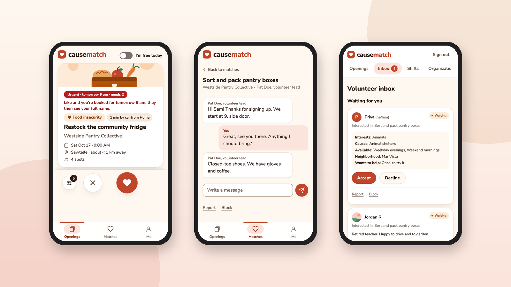

<p align="center">
  <picture>
    <source media="(prefers-color-scheme: dark)" srcset="docs/assets/logo/causematch-logo-dark.svg">
    
  </picture>
</p>

<p align="center">
  <a href="https://github.com/slegroux/causematch/actions/workflows/ci.yml"></a>
  
  
  
  
  <a href="LICENSE"></a>
  
</p>

<p align="center">
  <a href="https://slegroux.github.io/causematch/">Website</a> ·
  <a href="#features">Features</a> ·
  <a href="#quick-start">Quick start</a> ·
  <a href="docs/ARCHITECTURE.md">Architecture</a> ·
  <a href="docs/OPERATIONS.md">Operations</a> ·
  <a href="docs/OPERATIONS.md#security">Security</a>
</p>

<p align="center"><em>Swipe to volunteer.</em></p>

<p align="center">
  <br>
  <em>The volunteer's deck, a match chat, and the nonprofit's inbox (demo data, invented organizations).</em>
</p>

Causematch matches people with nonprofits across Los Angeles County that need a hand: food insecurity, environment and parks, animal shelters, homelessness services. Volunteers swipe through openings ranked for them, the nonprofit says yes too, and a chat opens. Open source, built with [FastHTML](https://fastht.ml), [MonsterUI](https://monsterui.answer.ai) and SQLite. Status: pre-launch; a password-protected preview is live.

## Features

| | |
|---|---|
| **Volunteers** | Sign in with a text code, answer a short onboarding, swipe on a phone. Each card says why it is shown; "Free in the next 48h" and a filter sheet narrow the deck. |
| **Match preferences** | Places you help from (never an address), causes, the days you're free, the kind of work and languages. Private. Causes, distance, timing and kind of work can each rank openings or hide the ones that don't fit; languages only rank. |
| **Nonprofits** | A dashboard to post openings anywhere in the county, accept volunteers and mark shifts done, with chat and shifts once matched (reminders once the scheduled job is set up). |
| **Last-minute calls** | Short of people in the next 48 hours? An urgent call texts (or emails) nearby volunteers who are free, with caps so nobody is spammed (once the scheduled job is set up). |
| **Privacy by design** | A nonprofit sees a volunteer as "Sam L." until it says yes, and only the fields the app lists as shared. Photos are re-encoded with no metadata, and sign-ins and texts are rate-limited. |

## Quick start

```sh
uv sync
uv run python scripts/demo.py     # throwaway database, invented demo data
uv run playwright install chromium  # once, for the browser tests
uv run pytest                     # the test suite
```

The demo prints how to sign in as a volunteer, a coordinator and an admin. As a volunteer, tap "Try it as a volunteer" on `/login` (or sign in with `(310) 555-0100` and the code `000000`): each sign-in gets its own copy of Sam, with matches, a chat and shifts, and nonprofits that say yes to a like a few seconds later. "Try it as a nonprofit" signs in the demo coordinator. Any other US mobile number works too and starts at onboarding. It never runs in production, and `scripts/screenshots.py --out DIR` screenshots every page of it.

## How it works

The server renders HTML with FastHTML and MonsterUI, htmx swaps the parts that change, and one SQLite database holds everything. Ranking turns each volunteer's preferences into a score per opening, and a match is two likes: the volunteer's, then the nonprofit's. Reminders and urgent waves run when Cloud Scheduler calls two endpoints, since the host scales to zero (those jobs are a launch step, not set up yet). The full picture is in [docs/ARCHITECTURE.md](docs/ARCHITECTURE.md).

## Project layout

```
main.py          app entry point (uvicorn flags match the Procfile)
app/             data, ranking, security, UI components
app/routes/      volunteer, nonprofit and admin pages
static/          htmx, Franken UI, compiled Tailwind, theme tokens, Nunito
scripts/         demo, demo video (scripts/video), screenshots, admin and import tools, CSS build
tests/           pytest suite
docs/            architecture and operations
```

## Deploying

Causematch runs on Google Cloud Run; a password-protected preview is live, and production adds Twilio, an email service, Cloud Scheduler for the two timed jobs and a persistent database. Configuration, the scheduler setup, the security model and the password-protected preview deploy are in [docs/OPERATIONS.md](docs/OPERATIONS.md).

## Contributing

- Lint with `uv run ruff check` and `uv run ruff format`, and add a test with every change.
- CI runs lint, the secret scan and the tests on pushes to main and on every pull request; run `uv run pytest` before you open one.
- `scripts/secret_scan.sh` runs gitleaks over the history; never commit real nonprofit data or secrets.

## License

[MIT](LICENSE)
