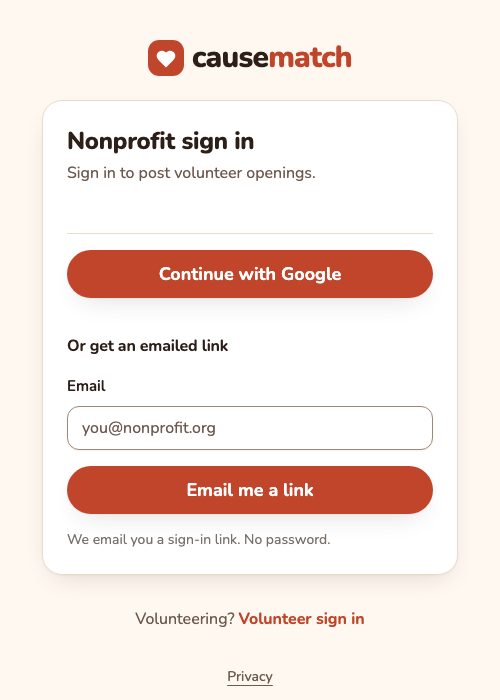
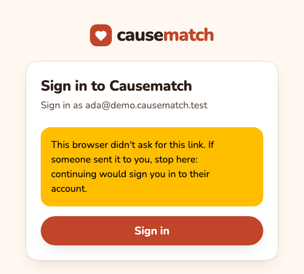
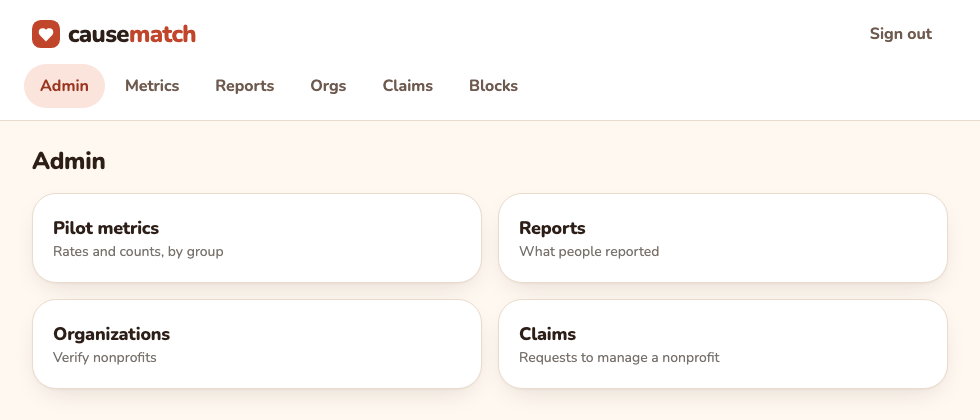
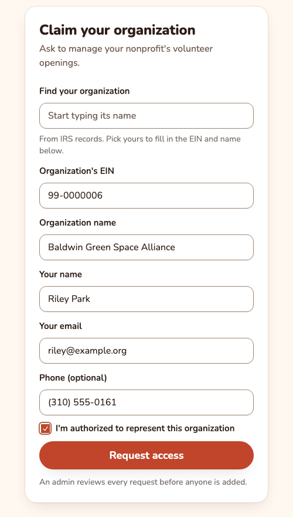
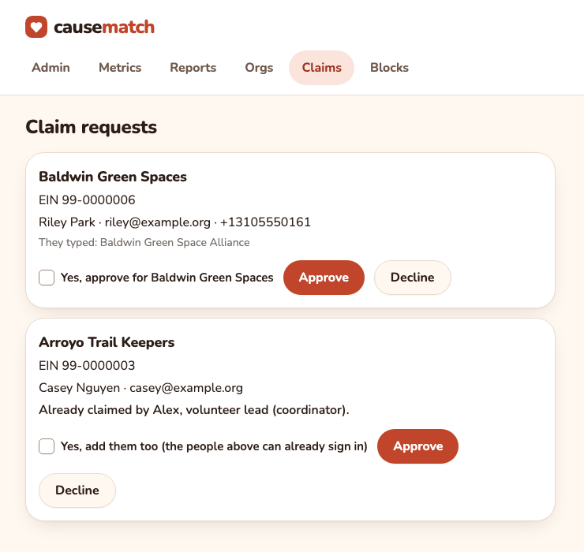
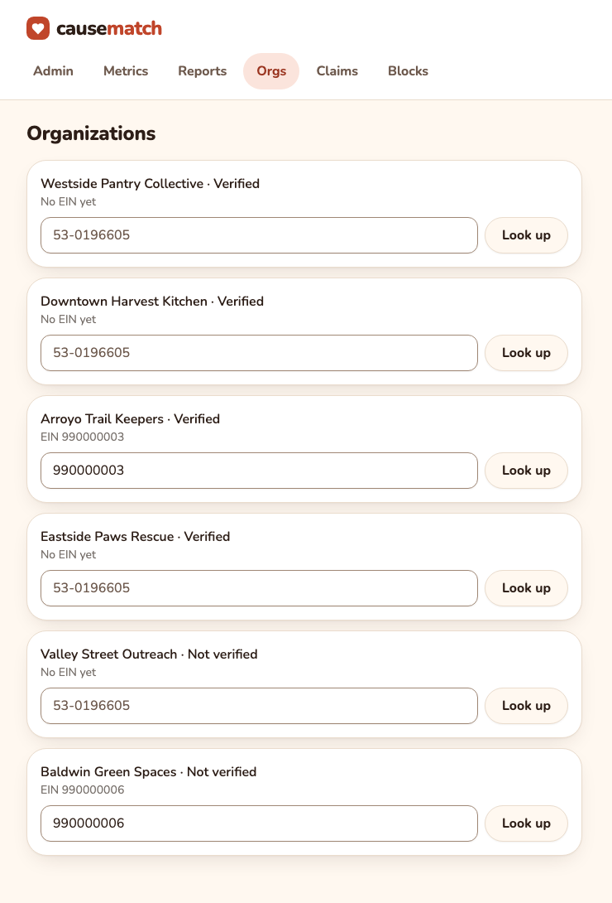
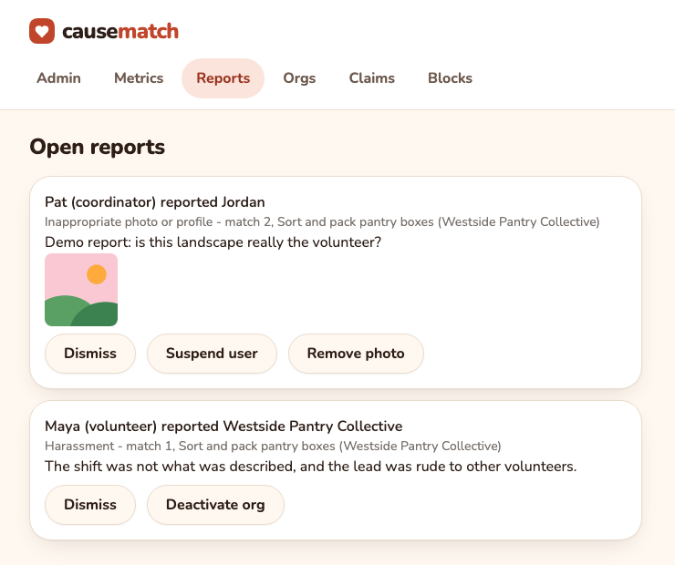
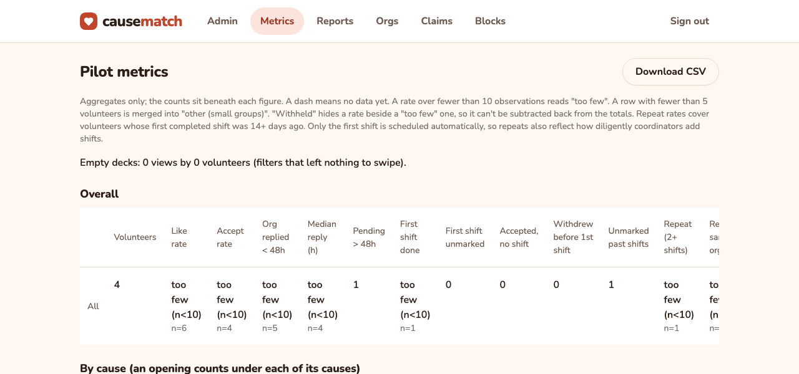

# Causematch admin guide

A short how-to for the admin running the beta. You don't need to be technical: everything below happens in a web browser, except a few things only the **operator** can do. The operator is whoever deploys and looks after the Causematch server; each of those steps names the command, so you can paste it into a message.

The screenshots use demo data: invented organizations and example.org addresses.

This guide is for the live (production) site. The **preview** is demo-only: it accepts only demo addresses, so a real address gets no link there, and the demo admin's link is in the server log instead of an email; there, **Try it as an admin** on `/org/login` signs you in as the demo admin in one tap, with one invented claim to approve. Don't approve real claims on the preview.

Nothing tells you when something new arrives. **No email or text goes to admins** when a nonprofit asks for access or someone files a report, so look at the Claims and Reports tabs every day or two.

Contents: [1. Signing in](#1-who-is-an-admin-and-how-to-sign-in) · [2. Claims](#2-approving-a-nonprofits-request-for-access-a-claim) · [3. Verifying a nonprofit](#3-verifying-a-nonprofit) · [4. Reports and blocks](#4-reports-and-blocks) · [5. Pilot metrics](#5-pilot-metrics) · [6. When something's off](#6-when-somethings-off)

---

## 1. Who is an admin, and how to sign in

An admin can see the admin pages and nothing else: the volunteer pages and the nonprofit pages (`/org`) are closed to you, so an admin can't swipe, post openings or chat. A person has one role per email address. An address that is already a coordinator can't also be an admin.

### Becoming an admin

Only the operator can add an admin. They run this against the live app (use your own address and name):

```sh
uv run python scripts/add_admin.py --email admin@example.org --name "Your Name"
```

It prints `admin@example.org is an admin (profile 2)`; the number is just an internal id. To take access away (you are signed out at once):

```sh
uv run python scripts/remove_admin.py --email admin@example.org
```

### Signing in

There is no password. You get a link by email.

1. Open `/org/login` on the Causematch site. This is the **nonprofit** sign-in page, and it is the one admins use too.
2. Type your admin email address and tap **Email me a link**.
3. Open the email "Your Causematch sign-in link" and tap the link. It works **once** and expires after **15 minutes**. Only the **newest** link works: asking again cancels the one before.
4. A confirm page opens. Check that it says **Sign in as** and your own address, then tap **Sign in**. You land on the Admin page.



#### The confirm page and its warnings

The link only shows you this page; nothing happens until you tap **Sign in**. That is so someone can't sign you in to *their* account by sending you a link.



- **"This browser didn't ask for this link. If someone sent it to you, stop here: continuing would sign you in to their account."** This is expected when you asked for the link in one browser or on one device and opened it in another (you requested it on your laptop and tapped it on your phone, say). If you asked for it, carry on. If you didn't ask for it, don't tap Sign in.
- **"This browser is signed in to another account. Continuing signs it out."** Tapping Sign in swaps that account for the one named on the page.
- **"That sign-in link has expired or was already used. Ask for a new one."** The link is older than 15 minutes, has been used, or a newer link replaced it. Go back to `/org/login` and ask again.

The sign-in page always answers "If that address belongs to a coordinator, a sign-in link is on its way", whether or not the address is known. That is on purpose, so strangers can't find out who has an account. If no email comes, see [When something's off](#6-when-somethings-off).

A **Continue with Google** (or Apple) button shows only when that sign-in is switched on. It works for you only when the email on that account is the one you were added with **and** Google or Apple itself hosts that mailbox: a Gmail or Google Workspace address for Google, an iCloud address for Apple. For any other address, such as a nonprofit's own domain on another mail service, the button sends you an emailed link instead.



The tabs along the top are **Admin**, **Metrics**, **Reports**, **Orgs**, **Claims** and **Blocks**. Sessions last 30 days.

---

## 2. Approving a nonprofit's request for access (a "claim")

Nobody gets a nonprofit account by signing up. They ask, and an admin says yes. This is the most important job you have.

### What the coordinator does

1. They open `/org/claim` ("Claim your organization").
2. They find their organization by typing its name (from IRS records) or by typing its **EIN**, then fill in the organization's name, their own name, their email and, optionally, a phone number.
3. They tick **I'm authorized to represent this organization** and tap **Request access**.
4. They see "Request received". They get no email at this point, and the page says the same thing whatever the EIN, so it never reveals which organizations exist.

Heads-up: that page tells them "If it is approved, a sign-in link will be emailed to the address you gave", but the approval email does **not** contain a sign-in link. It tells them to go to `/org/login` and ask for one. If a coordinator writes to say they got no link, this is why.



### What you see

Open **Claims** (the Admin page's "Claims" box, or the tab). Each pending request is a card, oldest first:



Each card shows:

- the organization's name and **EIN**, and its city when Causematch already has it;
- the person's name, email and phone (the phone appears in international form, `+1310...`);
- **They typed: ...** when the name they entered is not the name IRS records have for that EIN;
- **Already claimed by ...** when someone can already sign in for this organization;
- **New to Causematch: approving adds it from IRS records** when no organization has that EIN yet.

### Check before you approve

Approving gives a stranger the right to post openings, accept volunteers and chat with them, and it makes the nonprofit visible to volunteers. A minute of checking is worth it.

1. **Look up the EIN.** Search it on [ProPublica Nonprofit Explorer](https://projects.propublica.org/nonprofits/) (IRS public data). Confirm the name and city are the organization they say they are.
2. **Check the person really works there.** Some ways to do it, from easiest: does their email domain match the organization's website? Is their name on the organization's "team" or "contact" page? Call or write to the organization's published number or address (not one the requester gave you) and ask.
3. **Be wary of a mismatch.** If the card says "They typed: ...", someone may have put a harmless name beside a real nonprofit's EIN. Causematch makes you tick a second box to go ahead (see below).
4. **Free email addresses** (Gmail and the like) are not wrong, but they deserve step 2.

### Approve or decline

- **Approve.** Tap it. If the card has a checkbox, tick it first:
  - *Yes, approve for (name)* appears when the typed name differs from the IRS name. If you tap Approve without it, nothing is approved and the card explains: "IRS records name this EIN '...', not what they typed. Check it's right, tick ..., then tap Approve again."
  - *Yes, add them too (the people above can already sign in)* appears when the organization already has someone who can sign in. This is how you add a second coordinator ([see below](#a-nonprofit-needs-a-second-coordinator)).
- **Decline.** Tap it. It happens **at once**: there is no "are you sure?" and no way to undo it. The person gets a short, neutral email ("not approved"), with no reason and none of what they typed. If they should have been approved, they have to file a new claim (up to 3 a day per email address).

If the organization is **new to Causematch**, the first tap on Approve fetches it from IRS records. If the IRS name differs from what the person typed, you may then get the "tick ... then tap Approve again" message: tick the box and tap Approve a second time. The fetch can also fail, and then nothing changes:

- "We couldn't reach the IRS records (ProPublica)...": tap Approve again in a minute.
- "Too many IRS lookups this hour": try later. Lookups are limited to 30 an hour for all admins together.
- "Can't add this organization: ...": Causematch only takes organizations in Los Angeles County whose type of work fits one of its causes. Decline it, or ask the operator for help.

Approve can also be refused with a message on the card: the organization is **deactivated** (the card has no Approve button, only Decline), the address belongs to a **suspended coordinator**, or the address is an **admin's** (one address, one role). Decline those.

A green banner confirms the decision: "Approved. We emailed them a link to sign in." or "Declined. We let them know by email." If the email didn't go out, the banner says so ("Approved, but the email didn't send..." or "Declined, but the email to them didn't send."). The decision still stands. Tell the person yourself; after an approval they can sign in at `/org/login` with the email they used.

### What the coordinator gets

- An email, "You're approved on Causematch", with a link to `/org/login`. The email has no sign-in link itself (see the heads-up above). They type their email address there and Causematch sends the one-time sign-in link, as in section 1.
- Access to their organization: they are its **owner** if it had no owner who can sign in, otherwise a **coordinator**.
- A **verified** organization: approving a claim also verifies the organization if it wasn't ([section 3](#3-verifying-a-nonprofit)).

Causematch erases the name, email and phone on a request 90 days after you decide it.

---

## 3. Verifying a nonprofit

A new nonprofit starts **not verified**. Its openings stay out of every volunteer's deck until you verify it, so volunteers only ever see real, checked organizations. Once it is verified (and not deactivated), its openings appear in the decks of the volunteers they suit.

Two ways an organization becomes verified:

- **By approving its claim** (section 2). Nothing more to do.
- **By hand, from Orgs.** Use this for an organization that was imported but has no coordinator yet.



By hand:

1. Open **Orgs**. Each organization shows **Verified**, **Not verified** or **Deactivated**, and its EIN (or "No EIN yet").
2. Type the organization's EIN (nine digits, like `99-0000006`) in its box and tap **Look up**. The grey number you see in an empty box is only an example of how an EIN looks, not a real suggestion for that organization.
3. Causematch asks ProPublica and shows what it found: "ProPublica: *name*, *city*, *state* (EIN ...)". Check that this is the right organization.
4. Tap **Approve**.

If something is off you will see a message instead: "An EIN is nine digits", "ProPublica has no nonprofit with that EIN", "Try again in a minute", or "another org already has that EIN".

(The operator can do the same with `uv run python scripts/verify_org.py --ein 99-0000006 --org-id 1 --approve`.)

---

## 4. Reports and blocks

Volunteers can report the nonprofit of a match, and coordinators can report a volunteer, from the match. Reasons: harassment, a pattern of no-shows, "I felt unsafe", inappropriate photo or profile, spam, something else. They can add up to 1,000 characters of details, and may also block at the same time. Reports are limited to 10 a day per person.

### The reports queue

Open **Reports**. Each card says who reported whom, the reason, the match and opening it came from, and what they wrote. You see **first names only**: no email, phone or place.



What each button does:

| Button | Shows on | What it does |
|---|---|---|
| **Dismiss** | every report | Closes this report. Nothing else changes. |
| **Suspend user** | a report about a volunteer | The person **can't sign in**, every device they are signed in on is signed out, and their pending and accepted matches are withdrawn (future shifts cancelled). Every open report about them is closed as acted on. |
| **Remove photo** | a report about a volunteer who has a photo | Deletes their photo (they can add another). This report is closed; others about them stay open. |
| **Deactivate org** | a report about a nonprofit | The organization's openings close, pending matches are declined, accepted matches withdrawn, future shifts cancelled, and it leaves every deck and can't post, accept, schedule or message. Every open report about it is closed. |

Things to know before you tap:

- **Suspending and deactivating can't be undone from the admin pages.** There is no "un-suspend" or "reactivate" button. Ask the operator if you got it wrong.
- **The person isn't told.** Causematch sends no email or text for a suspension.
- A suspension follows the person's **email address** (a `+tag` or Gmail dots don't get around it) and their **Google or Apple account**, not a phone number: phones are only used for texts now. Even after they delete their account, a suspended person who signs up again with that address or account is refused.
- If the card says "Already suspended" or "Already deactivated", the earlier action already covers it: Dismiss it.

### One person, several accounts

**Suspend every account on the same mailbox.** A suspension belongs to a single account. It does **not** spread to other live accounts that already share the person's email address, so if you suspend one and leave the other, they can carry on under the other. Once one account is suspended, emailed links stop coming for that mailbox, but a separate Google or Apple account keeps working until it is suspended too. If you learn that a person has more than one account (the reporter may tell you, or the operator may spot it), suspend each of them.

Suspend lives on a report, and the queue shows only first names. So for the second account, ask the reporter to report it too from the match they have with it, or ask the operator which accounts share the address. Then tap **Suspend user** on each report.

### Blocks

Open **Blocks**. A block is one side shutting the other out: a volunteer blocking a nonprofit ("*Maya* (volunteer) blocked *Westside Pantry Collective*") or a nonprofit blocking a volunteer ("*Westside Pantry Collective* blocked *Jordan*").

When a volunteer blocks a nonprofit, its openings leave that volunteer's deck, their matches are ended and their chat becomes read-only. When a nonprofit blocks a volunteer, the volunteer's waiting likes there are declined, an accepted match is closed, their future likes are dropped without telling them, and the chat becomes read-only. Only an admin can undo a block: tap **Unblock**. The matches the block ended **stay ended**; the two sides can match again from scratch.

---

## 5. Pilot metrics

Open **Metrics** for how the pilot is going. The numbers are totals only: no names, emails or phones. **Download CSV** saves them all.



How to read the page:

- Under each figure is the count it is based on (`n=6`).
- A **dash** means no data yet.
- **"too few (n<10)"** means fewer than 10 cases, too few to quote as a percentage. Look at the count instead.
- A row with fewer than 5 volunteers is merged into **"other (small groups)"**, and a rate may show **"withheld"**, so nobody can work out one person's result by subtraction.
- The page is split **Overall**, **by cause**, **by how the org was introduced** (warm or cold) and **by how the volunteer heard of us**.

The columns, in plain words:

| Column | What it tells you |
|---|---|
| Volunteers | People who swiped, matched or had a shift in that row. |
| Like rate | Likes out of all swipes. |
| Accept rate | Of the volunteers a nonprofit answered, how many it said yes to. |
| Org replied < 48h | How often a nonprofit answered a like within two days. |
| Median reply (h) | The middle time, in hours, a nonprofit took to answer. |
| Pending > 48h | Likes still waiting after two days. A nonprofit to nudge. |
| First shift done | Of the volunteers whose first shift has a result, how many completed it. |
| First shift unmarked | First shifts that have happened but nobody has marked as done or a no-show. Ask the coordinator. |
| Accepted, no shift | Accepted matches with no shift at all (the volunteer was accepted but nothing was scheduled). |
| Withdrew before 1st shift | Accepted, then withdrawn before any shift. Counts as not showing up. |
| Unmarked past shifts | Every started shift still unmarked, not only first ones. |
| Repeat (2+ shifts) | Volunteers with two or more completed shifts, among those whose first completed shift was **at least 14 days ago**. |
| Repeat, same org | The same, with both shifts at one nonprofit. |
| Eligible for repeat | Shown as "of N": how many of the volunteers with a completed shift are old enough (first completed shift 14+ days ago) to count in the repeat rates. |
| No-show rate | No-shows out of completed shifts plus no-shows. |

"Empty decks" counts times a volunteer's filters left nothing to swipe. **Last-minute calls** shows urgent requests posted, how many were filled, the median minutes to fill and the no-show rate on those fills against ordinary shifts.

Remember: **only a volunteer's first shift is scheduled automatically.** The repeat numbers also reflect how diligently coordinators add later shifts, so a low repeat rate isn't always a volunteer problem.

---

## 6. When something's off

### A coordinator never got their sign-in link

1. Ask them to check spam and to wait a couple of minutes. The link is valid 15 minutes and works once, and only the newest link works, so tell them not to click an older email after asking again.
2. Make sure they typed the address **exactly** as in their claim or approval. Causematch says the same thing to every address, so it can't tell them it doesn't match.
3. They can ask again at `/org/login`, but there are limits: 5 links an hour from one device for an address, and 20 a day for an address (`+tags` and Gmail dots count as the same address). If they see "Too many tries", they should wait, up to an hour.
4. Only a **live coordinator of an organization**, or an admin, receives a link. Not these: a request still waiting on the Claims page, one you declined, or a suspended or deleted account.
   - An Apple "Hide my email" relay address never matches the email on file: they should use their real address, or the emailed link.
   - A link that opens a page saying it "has expired or was already used" was older than 15 minutes, already used, or replaced by a newer one.
5. Check the Claims page: if their request is still there, they are not approved yet.
6. If the banner said "Approved, but the email didn't send", no email went to them at all. Tell them to sign in at `/org/login`.
7. Still stuck: ask the operator to look at the email log.

### Someone wants their account deleted

- **A volunteer** can do it themselves: **Me**, then **Your profile**, then **Delete my account** at the bottom (they confirm once). It erases their name, phone, email and location, withdraws their matches and cancels future shifts, and replaces their chat messages with "[message removed]". The answers behind the pilot's statistics stay, without a name. Reports they filed or that name them stay too. If they were blocked, reported or suspended, Causematch keeps one-way hashes (not the values) of their email address, their phone number and any Google or Apple account, so a suspension or block can't be dodged by signing up again.
- **A coordinator or an admin** can't do it themselves: ask the operator. For a coordinator: `uv run python scripts/remove_coordinator.py --email coordinator@example.org` (this deletes the **whole account**: they are removed from **every** organization they belonged to, signed out at once, and their name and email erased; their chat messages stay as the nonprofit's record). For an admin: `scripts/remove_admin.py`, as in section 1.
- Anything else they ask to see or fix: the privacy page tells them to write to the contact address.

### A nonprofit needs a second coordinator

Two ways:

1. **Through a claim (best).** Ask the new person to fill in `/org/claim` with the organization's EIN and their own details. Their card on **Claims** says "Already claimed by ...". Do the usual checks, tick **Yes, add them too**, and tap **Approve**.
2. **By the operator**, without a claim:

   ```sh
   uv run python scripts/add_coordinator.py --email second@example.org --org-id 1 --name "Maria Lopez, volunteer coordinator"
   ```

   (`--org-id` is the organization's number, which admins can't see in the app: give the operator the organization's **name and EIN** and they will find it. Add `--role owner` to make them an owner.)

To remove a coordinator, the operator runs `scripts/remove_coordinator.py` as above. That removes the whole account from every organization; there is no script to take someone off just one.

### Quick reference

| I want to... | Go to |
|---|---|
| Approve or decline an access request | **Claims** |
| Verify a nonprofit by hand | **Orgs**, then Look up, then Approve |
| Review a report, suspend someone, deactivate a nonprofit | **Reports** |
| Undo a block | **Blocks**, then Unblock |
| Check how the pilot is going | **Metrics** |
| Add or remove an admin or coordinator | Ask the operator |
