# Causematch: architecture and features

This document has two readers in mind: a developer joining the project, and a technical partner who wants to know what the app does and how it is built.

- **Part 1 is a 10-minute tour.** It follows the [C4 model](https://c4model.com): first the people and outside services around Causematch, then the running pieces, then the parts inside the app. Each section has one picture and a few short paragraphs, and it ends with the handful of ideas that make the app work.
- **Part 2 is the reference.** Routes, modules, tables, flows, ranking weights, security rules, environments and tests, with file paths for everything.

File paths are relative to the repo root. "Live" means running in the password-protected preview on Cloud Run. Production is not deployed yet.

## Contents

**Part 1: The tour**

1. [The idea in one picture](#1-the-idea-in-one-picture)
2. [Level 1: system context](#2-level-1-system-context)
3. [Level 2: containers](#3-level-2-containers)
4. [Level 3: components inside the app](#4-level-3-components-inside-the-app)
5. [Key ideas](#5-key-ideas)

**Part 2: Reference**

6. [Features by role](#6-features-by-role)
7. [Request pipeline](#7-request-pipeline)
8. [Module map](#8-module-map)
9. [Data model](#9-data-model)
10. [Key flows](#10-key-flows)
11. [Matching and ranking](#11-matching-and-ranking)
12. [Security and privacy](#12-security-and-privacy)
13. [Environments and deploy](#13-environments-and-deploy)
14. [Testing and CI](#14-testing-and-ci)
15. [Where to go next, and a glossary](#15-where-to-go-next-and-a-glossary)

---

# Part 1: The tour

## 1. The idea in one picture

Causematch is an open-source (MIT), phone-first web app that works like a dating app for volunteering in Los Angeles County. Volunteers swipe through nonprofit openings ranked for them. When a volunteer likes an opening and the nonprofit says yes too, they are matched.

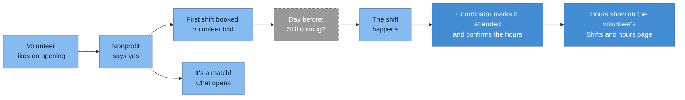

_Each box is one step a person sees. The darker boxes are the hours record. The dashed box waits for a scheduled job that is not set up yet._

A like creates a match that waits for the nonprofit. The nonprofit's yes books the first shift, tells the volunteer (by text, or by email when they have no phone number), and opens a chat. If the volunteer has the deck or Matches open, an "It's a match!" screen appears within about 10 seconds. Once the scheduled job that sends reminders is set up, a text the day before will ask "Still coming?". After the shift, the coordinator marks it attended and confirms how many hours the volunteer gave. Those **confirmed hours** add up, month by month, on the volunteer's own page. Some nonprofits also say they can confirm volunteer hours, and a volunteer can ask to see those first or only those. The code calls that preference **verified hours**.

Nonprofits short of people can also post an **urgent call**: "needs 2 more, tomorrow 9 am". It puts the card at the top of nearby volunteers' decks and can skip the yes step entirely (the first likes are booked at once). Once its scheduled job is set up, it will also text or email the volunteers who opted in.

The pilot covers four causes: food insecurity, environment and parks, animal shelters, and homelessness services (`app/db.py`, `CAUSES`).

**Volunteers**

- Sign in with Google, Apple or a code sent by text. A phone number is optional. A short first form asks for a first name, 18+, a Home place and how they feel about each cause.
- Swipe a ranked deck: Like or Pass. Each card says why it was picked ("♥ Animal shelters", "You're free Sat mornings").
- Keep matches apart from likes still waiting, chat once a nonprofit says yes, add a shift to their calendar, or cancel just one shift ("Can't make this one").
- Keep private preferences on four short pages, and opt in to last-minute calls.
- See upcoming shifts, past shifts and confirmed hours on one **Shifts and hours** page.

**Nonprofit coordinators**

- Ask for access to their organization (a claim), then sign in with a link sent by email, or with Google or Apple when that company hosts the mailbox.
- Post openings, say yes or no to likes in the Inbox, and chat with matched volunteers.
- Mark shifts attended (confirming the hours) or no-show, add shifts, and post urgent calls.

**Admins**

- Verify nonprofits against IRS records (ProPublica) and approve claims.
- Handle reports and blocks.
- Read the pilot's aggregate metrics. They never see names, phones or emails there.

## 2. Level 1: system context

Who uses Causematch, and which outside services it talks to.

Levels 1 to 3 use [C4 notation](https://c4model.com): each box gives an element's name, its kind (`[Person]`, `[Software System]`, `[Container]` or `[Component]`, with its technology) and what it does in a few words. Each arrow says what flows, with the protocol in brackets. The shape says the kind too: people are stadiums, external systems are rounded, data stores are cylinders, and a separate process has double sides.

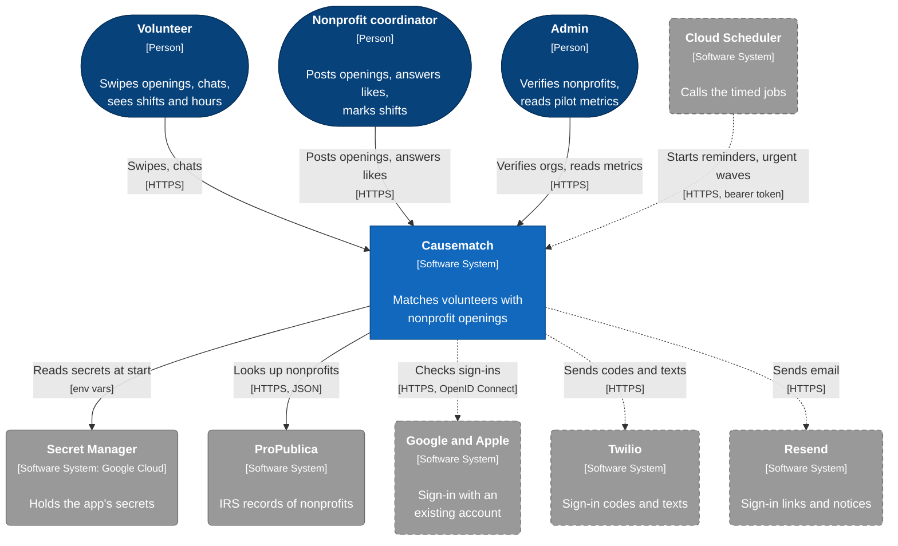

_Legend: dark-blue stadiums = people, blue box = Causematch, grey rounded boxes = external systems. A dashed grey box or arrow is built or planned but not live yet._

What is honest to say about each outside service today:

- **Google Cloud is live.** Causematch runs on Cloud Run in `us-west1` (the preview), and reads its secrets from Secret Manager. Hosting is where it runs, not something it talks to, so it is not an arrow here; section 13 has the deploy picture.
- **ProPublica is live.** The claim page's name search, the admin pages and two scripts read it.
- **Google and Apple sign-in is built but not live.** `app/oauth.py` has real clients for both, but the preview runs a fake: a local consent page (`CAUSEMATCH_FAKE_OAUTH=1`).
- **Twilio and Resend are built but not live.** `app/notify.py` has real clients for both, but the preview runs fakes: no text is sent (the code is always `000000`) and emails go to the log. Production refuses to start without Resend, and needs at least one of Twilio, Google and Apple for volunteers to sign in.
- **Cloud Scheduler is not set up.** The two endpoints it would call exist, but nothing calls them yet, so the preview sends no day-before reminders and no urgent waves on a timer.

The public website (`site/`, published to GitHub Pages by `.github/workflows/pages.yml`) is a static page with the demo video. It is not part of the running app.

## 3. Level 2: containers

In C4, a "container" is something that runs or holds data. Causematch has very few.

```mermaid
%%{init: {"flowchart": {"curve": "basis", "nodeSpacing": 40, "rankSpacing": 60}, "themeVariables": {"fontFamily": "Helvetica, Arial, sans-serif"}}}%%
flowchart TB
    vol(["<b>Volunteer</b><br/><small>[Person]</small><br/><br/>Swipes openings, chats,<br/>sees shifts and hours"])
    staff(["<b>Coordinator or admin</b><br/><small>[Person]</small><br/><br/>Runs openings, or<br/>verifies nonprofits"])

    subgraph cm["Causematch [Software System]"]
        direction TB
        ui["<b>Web pages</b><br/><small>[Container: HTML, htmx, small JS]</small><br/><br/>Server-rendered pages<br/>in the browser"]
        app["<b>Web application</b><br/><small>[Container: Python 3.12, FastHTML, uvicorn]</small><br/><br/>Pages, sign-in, ranking, matches,<br/>chat, task endpoints"]
        worker[["<b>Photo worker</b><br/><small>[Container: Python child process]</small><br/><br/>Decodes untrusted images<br/>under tight limits"]]
        db[("<b>Database</b><br/><small>[Container: SQLite file]</small><br/><br/>Every table, photos included")]
    end

    pp("<b>ProPublica</b><br/><small>[Software System]</small><br/><br/>IRS records of nonprofits")
    idp("<b>Google and Apple</b><br/><small>[Software System]</small><br/><br/>Sign-in with an<br/>existing account")
    twilio("<b>Twilio</b><br/><small>[Software System]</small><br/><br/>Sign-in codes and texts")
    resend("<b>Resend</b><br/><small>[Software System]</small><br/><br/>Sign-in links and notices")
    sched("<b>Cloud Scheduler</b><br/><small>[Software System]</small><br/><br/>Calls the timed jobs")

    vol -- "Uses<br/><small>[HTTPS]</small>" --> ui
    staff -- "Uses<br/><small>[HTTPS]</small>" --> ui
    ui -- "Forms, htmx swaps, chat<br/><small>[HTTPS, WebSocket]</small>" --> app
    ui -. "Consent page<br/><small>[HTTPS redirect]</small>" .-> idp
    app -- "Sends an upload,<br/>gets a clean JPEG<br/><small>[stdin/stdout]</small>" --> worker
    app -- "Reads and writes<br/><small>[apsw, one connection]</small>" --> db
    app -- "Looks up nonprofits<br/><small>[HTTPS, JSON]</small>" --> pp
    app -. "Checks ID tokens<br/><small>[HTTPS, OIDC]</small>" .-> idp
    app -. "Sends codes, texts<br/><small>[HTTPS]</small>" .-> twilio
    app -. "Sends email<br/><small>[HTTPS]</small>" .-> resend
    sched -. "Reminders, urgent waves<br/><small>[HTTPS, bearer token]</small>" .-> app

    classDef person fill:#08427b,stroke:#052e56,color:#ffffff
    classDef container fill:#438dd5,stroke:#2e6295,color:#ffffff
    classDef external fill:#999999,stroke:#6b6b6b,color:#ffffff
    classDef planned fill:#999999,stroke:#6b6b6b,color:#ffffff,stroke-dasharray:6 4
    class vol,staff person
    class ui,app,worker,db container
    class pp external
    class idp,twilio,resend,sched planned
    style cm fill:none,stroke:#888888,stroke-dasharray:8 4,color:#888888
```

_Legend: blue = containers inside the dashed Causematch boundary (cylinder = data store, double sides = a separate process); dark-blue stadiums = people; grey rounded boxes = external systems, dashed when not live yet._

**The browser.** Pages are plain HTML built on the server, so forms work without JavaScript. The pages still count as a container of their own because a good deal runs in the browser: htmx swaps, the websocket chat, the 10-second poll for a new match and a few small scripts. [htmx](https://htmx.org) is a small library that lets a button fetch a piece of HTML and swap it into the page. Causematch uses it for swiping, for the chat, and to ask every 10 seconds whether a nonprofit said yes. The chat uses a websocket, a connection that stays open so the server can push new messages. A few small scripts in `static/` add touches such as dragging a card (`swipe.js`), using the device location (`geo.js`) and shrinking a photo before upload (`photo.js`). A web app manifest and icons (static files, not a container) let people add Causematch to their Home Screen like an app (a PWA, "progressive web app"). For Google or Apple sign-in, the browser visits that company's consent page and comes back to `/auth/*/callback`.

**The web application.** One image (`Dockerfile`) runs uvicorn, a Python web server, which runs the app in `main.py`. The app is built with [FastHTML](https://fastht.ml), a Python framework in which each page is a Python function that returns HTML. The same app serves the two task endpoints that Cloud Scheduler would call (`/tasks/reminders` hourly, `/tasks/urgent` every 10 minutes); they are routes, not a separate container. Its secrets come from Google Cloud's Secret Manager as environment variables at start, which the picture leaves out. Photo uploads are decoded in a separate child process, `app/photo_worker.py`, with tight CPU and memory limits, so a hostile image can't harm the app.

**The SQLite file.** All data lives in one SQLite file, photos included, read and written through one shared connection.

**Why one process and one instance.** The SQLite file sits on the container's own disk. Open chat sockets and the token buckets live in that process's memory. (A token bucket is a per-user counter for rate limits: it allows a short burst, then refills at a steady rate.) A second instance would have its own copy of all three, so two people could see different data. The preview deploy therefore caps the service at one instance (`--max-instances 1`), and production would need the same cap, or shared state. Cloud Run also scales to zero when idle, so there is no background loop: timed work (reminders, urgent waves) waits for Cloud Scheduler to call an endpoint. In the preview the database is reseeded at each cold start. A persistent database for production (Litestream copying it to Cloud Storage) is planned, not built.

## 4. Level 3: components inside the app

Every request passes the same layers, top to bottom.

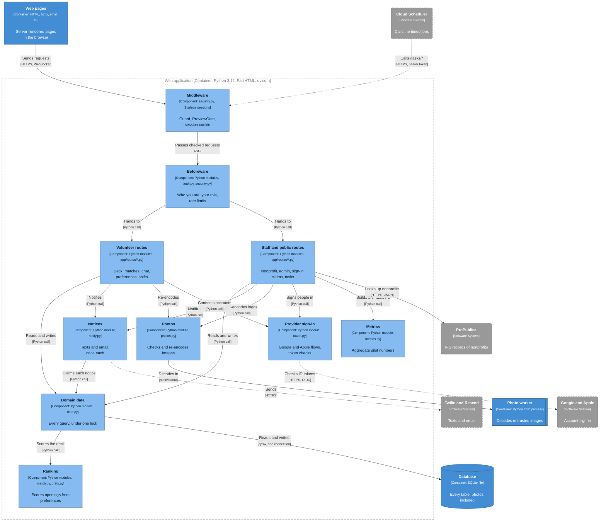

_Legend: light blue = components inside the Web application container (dashed boundary); mid blue = the neighbouring containers; grey rounded boxes = external systems, dashed when not live yet. Twilio and Resend are two systems drawn as one box here, to keep this diagram legible; Level 2 draws them apart._

**Middleware** is code that wraps every request before any page code runs. `security.Guard` refuses cross-site form posts and oversized bodies, and adds security headers. `security.PreviewGate` asks for the preview password (only in the preview). Then a signed session cookie says who is signed in.

**Beforeware** is FastHTML's name for checks that run before a page handler. `auth.check_session` makes sure the session is still valid and that the role fits the path: `/admin/*` is for admins, `/org/*` for coordinators, and the other signed-in pages for volunteers. `security.throttle` takes a token from the user's bucket for swipes, chat, reports and uploads.

**Routes** live in `app/routes/`, one file per area. They build HTML and never touch the database directly.

**The domain layer** is where the rules live. `app/data.py` holds every query the routes run, and every public function in it runs under one lock, because the single database connection is shared by all threads. `app/match.py` is pure scoring with no database access, so it is easy to test. `app/notify.py` sends texts and emails. `app/photos.py` checks and re-encodes images. `app/oauth.py` talks to Google and Apple and checks what they send back. `app/metrics.py` builds the admins' aggregate numbers from rows that `app/metrics_rows.py` reads. `app/propublica.py` is the ProPublica client that the claim page and the admin pages use (with `app/org_import.py` for imports); the picture folds it into the staff routes. Routes also read preferences directly through `app/prefs.py`.

**Storage.** `app/db.py` declares each table as a Python class. A migration is a numbered script in `app/migrations/` that usually changes data or structure that a class change alone can't. Pending migrations run at every start.

**Life of one request: a swipe.**

1. The volunteer taps Like or drags the card right. htmx sends `POST /swipe` with the opening's id.
2. `Guard` checks the request comes from the app's own origin. `PreviewGate` checks the access cookie (preview only). The session cookie gives the user id.
3. `auth.check_session` loads the profile, checks it is a volunteer who finished onboarding, and `security.throttle` takes one token from the swipe bucket (30, then 1 a second).
4. `app/routes/matches.py` moves the work to a thread and calls `data.swipe_created`.
5. Under the lock, `app/data.py` runs the same visibility check the deck uses, so a like sent by hand for a card the volunteer couldn't see is refused. It records the swipe and creates a `pending` match.
6. `notify.on_new_like` emails the org's coordinators, at most once per org every 15 minutes.
7. The handler returns only the HTML of the next card. htmx swaps it into the page and refreshes the number on the Matches tab. (After a volunteer's very first like, it sends them to two optional questions instead.)

## 5. Key ideas

These pictures are not C4 diagrams; they show how one idea works. They use the same colours: light blue for steps, mid blue for the result that matters, grey and dashed for what isn't live yet, and dark-blue stadiums for people.

### 5.1 A match is two likes

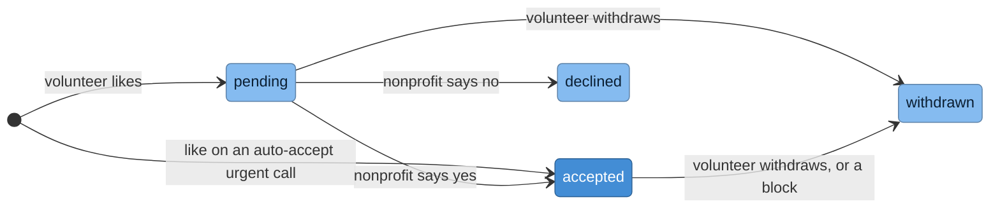

A like is the volunteer's half. It creates a `match` row in `pending`, listed under "Your likes" on the Matches page. The coordinator's yes is the other half: it moves the match to `accepted`, but only while the opening still has a free slot, in one database statement, so two quick yeses can't overbook. Accepting books the first shift, tells the volunteer and opens the chat. Withdrawing, a block either way, or the org's deactivation ends a match and cancels its future shifts. The full list of transitions is in [section 10](#10-key-flows).

### 5.2 How the deck is chosen

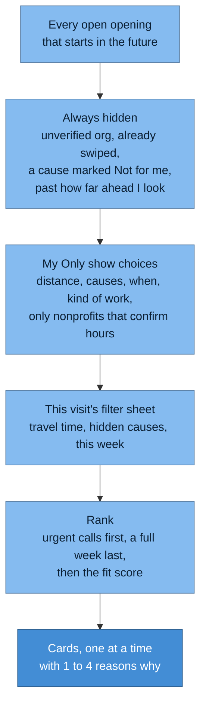

_Each step narrows the list; only the last one orders it._

The deck is a funnel, then a sort. Some rules always hide an opening, including one that starts beyond the volunteer's horizon: how far ahead they chose to look (this week, 2 weeks, a month or any time). Others only hide it when the volunteer chose "Only show" for that preference; otherwise the same preference just ranks the opening lower. Distance hides by default. The filter sheet changes the deck for this visit only and is never saved. The fit score (`app/match.py`) is a weighted sum of how well the causes, distance, times, skills, kind of work and languages fit, plus how quickly the org usually answers. When the deck is empty, the app offers the one change that would add the most cards. Weights and details are in [section 11](#11-matching-and-ranking).

### 5.3 Notifications are sent exactly once

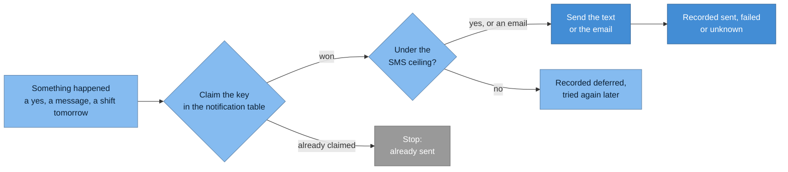

_The key, such as `reminder:{shift}`, is what makes a send happen once._

Every notice has a key that names the event: `accepted:{match}`, `reminder:{shift}`, `urgent:{call}:{volunteer}`. The `notification` table holds one row per key, with a unique index on it. Before sending, `app/notify.py` claims the key in one conditional database statement, so if a request is retried or two runs overlap, only one of them wins and sends. A volunteer gets a text when they have a number and Twilio is set up, otherwise an email; both use the same key, so nothing repeats. A failed send can be claimed again, up to 5 tries. A timeout is recorded `unknown` and is not retried, because the text may have arrived: a lost notice is better than a double text. A global ceiling caps texts per hour and per day, and a text over it is recorded `deferred`. The hourly sweep resends deferred accept and message texts; a deferred reminder goes again only if a later sweep still finds its shift 23 to 25 hours ahead; a deferred urgent text may be retried by the call's second wave.

### 5.4 Urgent calls go out in waves

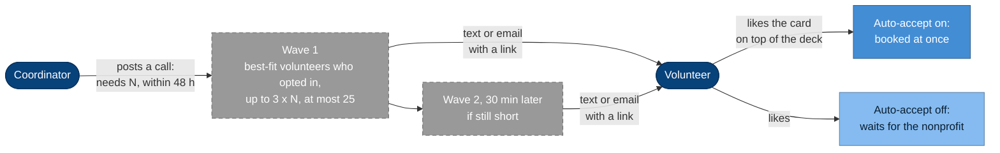

_The waves are dashed: they go out when Cloud Scheduler calls `/tasks/urgent`, planned every 10 minutes and not set up yet. The card ranking first works today._

An urgent call is "need N more people for this shift in the next 48 hours". Its card ranks first for every volunteer whose deck already holds that opening. Once the waves run, volunteers who opted in to last-minute calls will also get a text, or an email if they have no usable number. Notices go out in at most two waves, so a call never texts everyone at once. Each wave picks the best-fit volunteers who are free then, within travel time, outside their quiet hours, under their weekly cap of notices, and not already booked close to that time. An org may post 3 calls in any 24 hours. When a volunteer cancels a shift less than 48 hours ahead and gives up their spot, the app posts a call for 1 person by itself (a "refill").

### 5.5 Shifts and hours

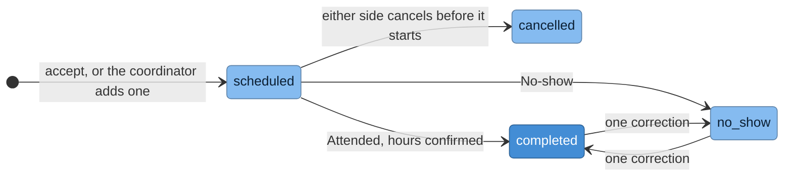

A **shift** is one dated occurrence of volunteering on an accepted match, with a length (1 to 8 hours), so its time reads as a range ("9:00 AM to 12:00 PM").

- **Before it starts**, the volunteer can answer "Still coming?" from the reminder's link, or cancel just that shift ("Can't make this one").
- **After it starts**, the coordinator taps Attended, which confirms the hours (pre-set to the shift's length), or No-show.
- **Confirmed hours** add up by month on the volunteer's **Shifts and hours** page.
- **Verified hours** is a private preference: Prefer, or Only show, the nonprofits that say they can confirm hours. Their cards say "Confirms your hours".

The exact rules are in [section 10](#10-key-flows), flows (g) and (h).

### 5.6 Privacy: who sees what

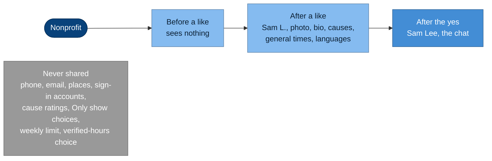

_What a nonprofit sees grows with each step. The grey box never leaves the volunteer's account._

A nonprofit learns about a volunteer only when that volunteer likes one of its openings. Then it sees what the volunteer agreed to share, with the name cut to first name and last initial ("Sam L."). The full last name appears once the nonprofit says yes. Places are stored as an area, never an address, and cards show the travel minutes from the nearest place, never coordinates. Photos are re-encoded on the server, which strips location data. Blocks work both ways and hide a volunteer's details from that org at once. The full table, with file paths, is in [section 12](#12-security-and-privacy).

---


# Part 2: Reference

## 6. Features by role

Volunteers see a bottom tab bar with **Openings** (`/deck`), **Matches** (`/matches`) and **Me** (`/profile`), defined in `app/ui.py` (`TABS`). The Matches tab carries a small number: how many of the volunteer's likes a nonprofit accepted or declined since they last opened Matches, "9+" past nine (`app/ui.py`, `MatchesDot`; `data.match_news_count`). Their own likes still waiting don't count. Coordinators see a top nav with **Openings** (`/org`), **Inbox**, **Shifts** and **Organization** (`ORG_TABS`). The Inbox tab counts the likes waiting for an answer plus the chats owed a reply. Admins see **Admin**, **Metrics**, **Reports**, **Orgs**, **Claims** and **Blocks** (`app/routes/admin.py`, `ADMIN_TABS`).

### Volunteer

| Feature | What it does | Route(s) | Code |
|---|---|---|---|
| Sign in by text code | Enter a US mobile number and get a 6-digit code by SMS (Twilio Verify). The first sign-in creates the account. Without Twilio configured, the phone form isn't shown and these routes answer 404. In a demo (`CAUSEMATCH_DEMO_MATCHES=1`) a "Try it as a volunteer" button signs in a fresh demo volunteer in one tap; elsewhere that route answers 403. | `GET /login`, `POST /login/send`, `POST /login/verify`, `POST /login/demo`, `POST /logout` | `app/routes/auth.py`, `app/auth.py`, `app/notify.py` |
| Sign in with Google or Apple | "Continue with Apple" and "Continue with Google" on `/login`, each shown only when configured. The provider's verified email is required. The first sign-in creates a volunteer with no phone, that email and the given name; onboarding offers the Google profile picture behind an unticked box. See 10c. | `GET /auth/{google,apple}/start`, `GET /auth/google/callback`, `POST /auth/apple/callback` | `app/routes/oauth.py`, `app/oauth.py` |
| Sign-in methods and reach | Under Me, Your profile: the masked phone, each provider connected ("Connected as" its email, Disconnect) or offered (Connect), never removing the last way in; and how notices arrive, by text to the number or by email, with a form to add and verify a number while Twilio is configured. A disconnect signs out every other session. | `POST /me/identity/{google,apple}/{connect,disconnect}`, `POST /me/phone/send`, `POST /me/phone/verify` | `app/routes/profile.py`, `app/routes/oauth.py` |
| Onboarding | A short form: first name, 18+ confirmation, a Home place (neighborhood, ZIP or device location) with travel mode and time (car, 30 minutes to start), causes rated love / open / not for me, and consent. After a Google or Apple sign-in the first name comes prefilled and the email is kept; Google's profile picture is offered behind an unticked "Use my Google photo" box. Volunteers can't reach the rest of the app until it is done. After the first like, one optional card asks whether they volunteered in the last 12 months and how they heard of us; it is shown once. Free times, email and the rest are set later under Me. | `GET/POST /onboarding`, `GET/POST /onboarding/more` | `app/routes/onboarding.py` |
| Preferences | Kept private, unless a page says what a nonprofit sees. An index with four pages, each its own form that posts only its own fields, so saving one leaves the others as they were. **Causes and places:** the three-state cause ratings, "Nonprofits that confirm my hours" (no preference / Prefer / Only show), "Surprise me", and up to 2 places, each with mode and max travel time. A saved second place stays folded behind a one-line summary ("Venice · Walk, up to 15 min"), and opens only after a failed save. **When:** a 7×3 day grid, up to 10 specific free dates, how far ahead to look, one-time or recurring, and "Up to this many shifts a week" (off, 1 to 5). **Kind of work:** setting, effort, group size, first-timer friendly, whether a separate orientation is OK, spoken languages, how often, and skills (`choices.SKILLS`, music, art and performing among them). **Last-minute calls:** see below. | `GET /me/preferences`, `GET /me/preferences/causes`, `.../when`, `.../work`, `.../urgent`, `POST /me/preferences` | `app/routes/prefs.py`, `app/prefs.py` |
| Dealbreakers ("Only show") | For each of causes, distance, when and kind of work, the volunteer picks whether it only ranks openings or also hides those that don't fit. Each toggle sits on the page of the preference it governs. Distance hides by default. "Not for me" causes always hide. | part of the preference pages | `app/choices.py` (`DEALBREAKERS`), `app/data.py` |
| Swipe deck | One card at a time. Each card shows a photo, title, org, causes, the time as a range when the opening gives a shift length, the travel minutes from the nearest place with the neighborhood ("7 min by car · Palms"), or the neighborhood alone when the volunteer has no place, or "Remote" for a remote opening, and 1 to 4 "why" chips. A card within 4 hours of a shift the volunteer already has says "You're booked at {org} then"; a card in a week that is already full says "Your week is full". Like or Pass by button or by dragging sideways; the number of openings shows under the buttons. Swipes are sent by htmx. A nonprofit's yes arrives as an "It's a match!" takeover (see the next row). | `GET /`, `GET /deck`, `POST /swipe` | `app/routes/deck.py`, `app/routes/matches.py`, `app/data.py`, `app/match.py`, `static/swipe.js` |
| "It's a match!" | A full-screen takeover: the nonprofit's face and the volunteer's picture with a heart, the nonprofit and the opening, then Say hi and Keep swiping (Close on Matches). Several new matches at once are listed under it. It arrives live: the deck and Matches pages ask `GET /deck/news` every 10 seconds and when the tab comes back, and a swipe's answer carries it too. The poll's answer lands in a slot outside the deck, so a later swipe doesn't reset it. With nothing new, the poll only refreshes the Matches number. Claiming the new matches is one conditional update, so two requests never both draw it. | `GET /deck/news` | `app/routes/deck.py` (`MatchSheet`, `MomentSlot`), `app/data.py` (`new_matches`), `static/sheet.js` |
| "Next 48h" | A switch that limits the deck to shifts starting in the next 48 hours, sorted soonest then nearest. | `GET /deck?today=1` | `app/routes/deck.py` |
| Filter sheet | Temporary filters for this visit, stored in the session and never in saved preferences: the main place's travel time, causes to hide, and this week only. | `POST /deck/filters` | `app/routes/deck.py` |
| Empty-deck help | When nothing is left, the app offers the one change that would add the most cards (widen a travel time, look further ahead, drop a dealbreaker, show nonprofits that don't confirm hours, or clear filters). | `POST /deck/relax` | `app/routes/deck.py`, `app/data.py` |
| Matches | Three parts: "Matches" (the nonprofits that said yes), "Your likes" (likes still waiting, with a line saying a like becomes a match when the nonprofit says yes), and a closed "Past" fold for declined and withdrawn ones, which opens and counts them when a decline is new. Status labels: Waiting for the nonprofit, Accepted, Not this time, Withdrawn (`app/ui.py`, `MATCH_STATUS`). An accepted card has a Chat button, the next shift with a "Can't make this one" link, and Add to calendar (an `.ics` file and a Google Calendar link). Withdraw, Report and Block sit under "More". Withdrawing a pending or accepted match cancels its future shifts; withdrawing an accepted one emails the org. A link at the top opens Shifts and hours. | `GET /matches`, `GET/POST /matches/{id}/withdraw`, `GET /shifts/{id}.ics` | `app/routes/matches.py`, `app/routes/shifts.py`, `app/ui.py` |
| Chat | Opens once the nonprofit accepts. Messages arrive live over a websocket, and a plain POST form works as a fallback. The chat becomes read-only after a withdrawal, a block either way, or the org's deactivation. | `GET /chat/{id}`, `POST /chat/{id}/send`, websocket `/chat/{id}/ws` | `app/routes/chat.py`, `static/chat.js` |
| Shifts and hours | The first shift is booked automatically on accept when the opening's (or urgent call's) start is still ahead; otherwise the coordinator adds one. One page, titled "Shifts and hours", lists upcoming and past shifts, then the hours: confirmed hours by month, each shift with its nonprofit and the coordinator who confirmed it, and apart from those any attended shifts that have no confirmed hours. `/hours` redirects there. | `GET /history`, `GET /hours` | `app/routes/shifts.py`, `app/routes/hours.py`, `app/data.py` (`my_shifts`, `my_hours`) |
| Still coming? | A day-before reminder (a text, or an email without a number) ends with a link to this page, sent when `/tasks/reminders` runs (planned hourly Cloud Scheduler job, not set up yet). "Yes, I'll be there" stamps the shift once, and the coordinator then sees "Confirmed". "Can't make it" leads to the cancel page. The link carries no sign-in token. | `GET/POST /shifts/{id}/confirm` | `app/routes/shifts.py`, `app/notify.py` |
| Can't make this one | The volunteer cancels one upcoming shift, with an optional reason (up to 300 characters). On a recurring or flexible opening the match stays. On a one-time opening that is open or filled, cancelling the only upcoming shift ends the match as a withdrawal would. The org's coordinators get an email at once, without the volunteer's name. Less than 48 hours ahead, a spot given up refills itself with an urgent call for 1 person (see 10g). Linked from Matches and from the chat. | `GET/POST /shifts/{id}/cancel` | `app/routes/shifts.py`, `app/data.py` (`cancel_my_shift`), `app/notify.py` |
| Profile and photo | What nonprofits see: photo, first and last name, pronouns, short bio, up to 6 interests (chips from a list), and the neighborhood nonprofits see. Under "Only we see": an optional email (for last-minute calls when the volunteer has no texts) and any other cause they'd like, as free text. The photo is re-encoded server-side and can be removed. Delete my account is at the foot of this page. | `GET /me/profile`, `POST /me/profile/photo`, `POST /me/profile/photo/remove`, `POST /me/profile/details` | `app/routes/profile.py`, `app/photos.py` |
| Photo nudge | A prompt under the deck to add a photo, until the volunteer adds one or taps "Not now". | `POST /deck/photo-nudge/dismiss` | `app/routes/deck.py` |
| Last-minute calls | Opt-in, on `/me/preferences/urgent`. Choose same day or today-and-tomorrow, quiet hours, and up to 3 notices a week. Notices arrive by SMS, or by email for volunteers who have no usable number. Waves go out when `/tasks/urgent` runs (planned every 10 minutes, not set up yet). Every email carries a signed unsubscribe link that works signed out. | `GET /me/preferences/urgent`; `GET/POST /urgent/off/{key}` | `app/routes/prefs.py`, `app/notify.py`, `app/data.py` |
| Report and block | From a match, the volunteer can report the org (reason plus details) or block it. A block removes the org's openings from the deck, withdraws open matches and makes chat read-only. | `GET/POST /matches/{id}/report`, `GET/POST /matches/{id}/block` | `app/routes/safety.py` |
| Me hub, privacy, delete account | The hub links to Your profile, Preferences, Shifts and hours (each with a one-line subtitle) and the privacy policy; Sign out is a button. Deleting the account (from the profile page) soft-deletes and scrubs it. | `GET /profile`, `GET/POST /profile/delete`, `GET /privacy` | `app/routes/safety.py` |
| Add to Home Screen | A web app manifest and icons, plus an iPhone Safari hint on the deck. | `/static/manifest.webmanifest`, `GET /favicon.ico` | `app/routes/pwa.py` (favicon), `static/manifest.webmanifest`, `static/a2hs.js` |

### Nonprofit coordinator

| Feature | What it does | Route(s) | Code |
|---|---|---|---|
| Sign in by email link | Enter an email address to receive a single-use link that expires in 15 minutes. Only addresses of coordinators with an org membership (or of admins) get a link, and the page answers the same way for every address (a preview with the fake emailer shows a coordinator's link instead, see 10b). In a demo, "Try it as a nonprofit" signs in the demo coordinator in one tap; elsewhere that route answers 403. | `GET /org/login`, `POST /org/login/send`, `POST /org/login/demo`, `GET/POST /org/login/verify` | `app/routes/org_auth.py`, `app/notify.py` |
| Sign in with Google or Apple | The same buttons on `/org/login`. The provider's verified email must be the coordinator's (or admin's) email on file, found as the link finds it, and the provider must host that mailbox (Gmail, a Google Workspace account whose domain matches, or iCloud); for any other address the answer is the emailed link's. Nothing is ever created: an unknown address gets a pointer to `/org/claim`. | `GET /auth/{google,apple}/start?for=org` and the callbacks | `app/routes/oauth.py`, `app/oauth.py` (`authoritative`), `app/data.py` (`staff_by_email`) |
| Ask for access (claim) | A public form: EIN, org name, the requester's name, email and optional phone, and an "I'm authorized" box. It creates a pending claim that an admin decides. Typing the org's name searches IRS records (ProPublica, California 501(c)(3)s, `static/claim.js`) and picking one fills the EIN and name; the search reads ProPublica only, never the orgs table, so it can't tell whether an org is on Causematch or claimed. Typing the EIN still works, and is the fallback when the search fails. | `GET/POST /org/claim`, `GET /org/claim/search` | `app/routes/claim.py` |
| Openings dashboard | Lists the coordinator's openings for each of their orgs, with counts and any open urgent call, and a "messages to answer" link when a volunteer wrote last. A coordinator with no name yet sets their name, role and optional phone here first (after that, "Your details" lives on the Organization page). Posts new openings and closes them. | `GET /org`, `POST /org/details`, `GET/POST /org/openings/new`, `POST /org/openings/{id}/close` | `app/routes/org.py` |
| Opening form | Title, about, cause, ZIP (LA County; the neighborhood fills in from a local table, `static/zip.js`), neighborhood, next start (within 12 months), how long a shift is (1 to 8 hours), recurrence (one-time / weekly / monthly / flexible), slots (1 to 200), orientation, a preferred reply channel (stored; notices are email-only today), up to 3 skills, kind of work, helpful languages, notes, and a required confirmation that the opening is adults-only with no one-to-one contact. | `/org/openings/new`, `GET /org/zip` | `app/routes/org.py` |
| Inbox, accept and decline | Starts with "Messages to answer" when there are any: accepted chats whose latest message is the volunteer's. A reply from anyone at the org clears it, and blocked, withdrawn or deactivated chats never wait. Then groups likes into "Waiting for you", "Decided" and "Past matches". Each row shows only what the volunteer agreed to share. Accepting books the first shift (when its start is still ahead) and texts the volunteer. | `GET /org/inbox`, `POST /org/matches/{id}/decide` | `app/routes/org.py`, `app/data.py` (`org_inbox`, `org_unanswered`) |
| Chat | The coordinator side of the same chat. | `GET /org/chat/{id}`, `POST /org/chat/{id}/send`, websocket `/org/chat/{id}/ws` | `app/routes/chat.py` |
| Shifts and attendance | Three lists: "Did they come?" (started, not marked), "Marked this week" and "Upcoming". An upcoming shift reads "Confirmed" once the volunteer said they're coming. Marking a started shift Attended confirms its hours: the choice is pre-set to the shift's length, and the coordinator can pick 30 minutes to 12 hours, but no more than the longer of the shift's length and the time since it started; a shift with no length asks for its hours. No-show confirms none. One correction (of the result or the hours) is allowed within 7 days. The coordinator can also cancel a future shift, add another shift (with its own length), or repeat "same time next week" for weekly openings. | `GET /org/shifts`, `POST /org/shifts/{id}/mark`, `POST /org/shifts/{id}/cancel`, `GET/POST /org/matches/{id}/shifts/new`, `POST /org/matches/{id}/shifts/repeat` | `app/routes/shifts.py`, `app/data.py` (`complete_shift`) |
| Org profile and media | Org about text and website (https only), a "We can confirm volunteer hours" box (off by default), a logo and a photo of the org's work, and the coordinator's own details. Each opening can have its own photo and a link to the org's own event page. | `GET /org/organization`, `POST /org/organization/{org_id}`, `.../{org_id}/logo`, `.../{org_id}/photo`, `GET /org/openings/{id}/media`, `POST /org/openings/{id}/photo`, `POST /org/openings/{id}/link` | `app/routes/org_profile.py`, `app/photos.py` |
| Urgent calls | For a shift in the next 48 hours, the coordinator posts "need N more" on an open opening, optionally auto-accepting the first N likes. Limit: 3 calls per org per 24 hours. A call can be stopped early. | `GET/POST /org/openings/{id}/urgent`, `POST /org/openings/{id}/urgent/close` | `app/routes/org.py`, `app/data.py`, `app/notify.py` |
| Report and block a volunteer | Report or block a volunteer from a match. A block declines pending likes, withdraws an accepted match and silently drops the volunteer's future likes. | `GET/POST /org/matches/{id}/report`, `GET/POST /org/matches/{id}/block` | `app/routes/safety.py` |
| Email notices | "New volunteer interest" (at most one per org per 15 minutes), "a volunteer was accepted automatically" for urgent calls, "a volunteer can't make" a shift (with their reason, and whether an urgent call went out or could be posted), and "a volunteer withdrew" from an accepted match. The last two never name the volunteer: the link does. | sent by `app/notify.py` | `app/notify.py` |

### Admin

| Feature | What it does | Route(s) | Code |
|---|---|---|---|
| Sign in | Admins use the same emailed link, or Google or Apple by verified email, as coordinators and land on `/admin`, the admin home. They can't open volunteer or `/org` pages. | `/org/login`, `GET /admin` | `app/routes/org_auth.py`, `app/auth.py` |
| Org verification | An org's openings stay out of every deck until it is verified. The admin looks the EIN up on ProPublica Nonprofit Explorer, then verifies. | `GET /admin/orgs`, `POST /admin/orgs/{id}/lookup`, `POST /admin/orgs/{id}/verify` | `app/routes/admin.py`, `app/propublica.py` |
| Claims | Pending access requests as cards (org, city, EIN, the person, their email) with Approve and Decline, and a one-line confirmation after each. If no org has the claim's EIN, Approve imports it from ProPublica first (as `scripts/import_orgs.py --ein` does), in the same tap; when ProPublica fails, the card says so and Approve retries. Approving makes the requester the owner (or a coordinator if the org already has an owner) and verifies the org. If the org already has people who can sign in, the admin must confirm adding another. When the typed name differs from the IRS name, the card shows both and Approve needs a "Yes, approve for {IRS name}" box ticked. Approval is refused for a deactivated org or a suspended coordinator's address. Both decisions are emailed. | `GET /admin/claims`, `POST /admin/claims/{id}/approve`, `.../reject` | `app/routes/admin.py`, `app/org_import.py` |
| Reports queue | Dismiss a report, suspend the reported volunteer, deactivate a reported org, or remove a reported volunteer's photo. | `GET /admin/reports`, `POST /admin/reports/{id}/dismiss`, `.../suspend`, `.../deactivate`, `.../remove-photo` | `app/routes/admin.py`, `app/data.py` |
| Blocks | Lists blocks and lets the admin undo one. | `GET /admin/blocks`, `POST /admin/blocks/{id}/unblock` | `app/routes/admin.py` |
| Pilot metrics | Aggregates only: like rate, accept rate, reply within 48 h, first and repeat shifts, no-shows, empty decks and last-minute call figures. Broken down by cause, by how the org was introduced, and by how the volunteer heard of us. Small groups are merged and thin rates show as "too few". Downloadable as CSV. | `GET /admin/metrics`, `GET /admin/metrics.csv` | `app/metrics.py`, `app/metrics_rows.py` |

Some admin tasks are command-line scripts in `scripts/`:

- `add_admin.py`, `remove_admin.py`: grant or revoke admin access.
- `add_coordinator.py`, `remove_coordinator.py`: grant coordinator access or delete a coordinator.
- `verify_org.py`: look an EIN up on ProPublica and, with `--org-id N --approve`, verify that org.
- `import_orgs.py`: import nonprofits from ProPublica.
- `stats.py`: print headline numbers from a read-only database.

---

## 7. Request pipeline

`main.py` builds the app with `fast_app(...)`. FastHTML places user middleware ahead of its own session middleware, and Starlette runs the first middleware in the list outermost. The resulting order, inside Starlette's own `ServerErrorMiddleware` (outermost), with Starlette's `ExceptionMiddleware` (the 404 page) between the session and the router, is:

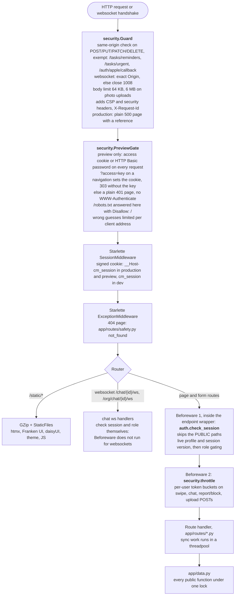

### Auth, sessions and roles (`app/auth.py`)

- **Public paths** skip the sign-in check: `/login`, `/login/send`, `/login/verify`, `/login/demo`, `/auth/*` (Google and Apple sign-in, 404 when not configured), `/org/login`, `/org/login/send`, `/org/login/verify`, `/org/login/demo`, `/org/claim`, `/org/claim/search`, `/privacy`, `/tasks/reminders`, `/tasks/urgent`, `/urgent/off/{key}`, `/favicon.ico` and `/static/*`.
- **Session contents:** `uid` and `sv`, the session version. A request is signed in only if the profile still exists and isn't deleted or suspended, and `sv` equals the profile's `session_version`. Bumping that version signs out every device; sign-out, suspension and account deletion bump it. A Google or Apple connect from Me is sealed with it, so one started before a sign-out is refused. A deleted or suspended profile fails the check anyway, so removing an admin or coordinator also takes effect at once.
- **Role gating:**
  - `/admin/*`: admins only. A coordinator who tries is redirected to `/org`, anyone else gets 403.
  - `/org/*`: coordinators with at least one current org membership, checked on every request. Others get 403.
  - Volunteer pages: volunteers only. A coordinator is redirected to `/org`, and an admin gets 403.
  - A volunteer who hasn't finished onboarding is redirected to `/onboarding` (`/logout` stays reachable).
  - `/photos/*` is open to every signed-in role. `app/data.py` then decides who may see each photo (see section 12).
- **Websockets** apply the same rules through `auth.ws_session_user`, on connect, on every frame and before each push. It also refuses a volunteer who hasn't finished onboarding.
- Unmatched paths reach the 404 handler without running any Beforeware.
- Ownership of a single row is checked in `app/data.py`, not here. For example the pages that act on one shift (`/shifts/{id}/cancel`, `/shifts/{id}/confirm`, `/shifts/{id}.ics`) go through `data.shift_event`, which accepts only the volunteer's own upcoming shift on an accepted match; anything else answers 404.

### htmx partials and full pages

Most pages are plain server-rendered HTML with ordinary form POSTs and redirects, so they work without JavaScript. htmx is used in three places:

- **Swiping.** The Like/Pass form posts with `hx-post="/swipe"` and swaps `#deck-area` with the next card. `POST /swipe` checks `HX-Request`: for htmx it returns the partial, or an `HX-Redirect` to the chat when an urgent call auto-accepted the like, or to `/onboarding/more` after the volunteer's first like (the two optional questions). The partial also carries the Matches number as an out-of-band swap, and any new "It's a match!" takeover. Without htmx it redirects to `/deck`.
- **The match moment.** On the deck and Matches pages, `#moment-slot` asks `GET /deck/news` every 10 seconds and when the tab becomes visible again (`static/sheet.js` skips a hidden tab). A new match comes back as the takeover; with nothing new the answer is only the Matches number, with `HX-Reswap: none`, so a takeover already open stays.
- **Chat.** The page connects with htmx's `ws` extension. The server pushes each new message to every open socket on that match as an out-of-band swap appended to `#messages`. `static/chat.js` reloads from the server's copy when the socket reconnects after a drop, or when the server refuses it with 1008. Each user may hold 5 sockets per match and 20 overall, and each frame takes a token from the chat bucket (close code 1013 when empty). `POST /chat/{id}/send` is the no-script fallback.

htmx, its ws extension, Franken UI and daisyUI are vendored under `static/vendor/`. `htmx-config` turns off eval and script tags.

---

## 8. Module map

The main imports, one layer at a time. Arrows read "imports / calls". Route modules never touch `app/db.py` directly: all reads and writes go through `app/data.py`. Left out to keep it readable: `app/config.py` (environment rules, read by most modules), `app/ui.py` and the other shared helpers every route uses, `main.py` (which assembles everything), `app/demo_seed.py`, smaller cross-imports (`app/notify.py` uses `app/security.py`, `app/oauth.py` uses `app/auth.py`, `app/security.py` uses `app/photos.py`), and one lazy import from `app/notify.py` back to `app/routes/chat.py` (`volunteer_online`).

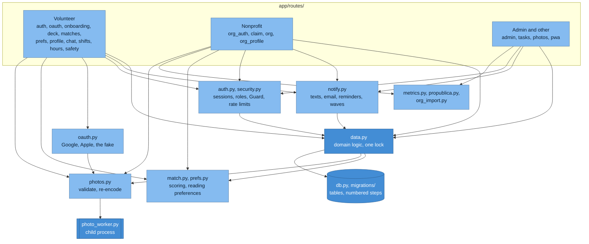

| Module | Responsibility |
|---|---|
| `main.py` | Startup refusals (environment, secrets, providers), uvicorn settings, `fast_app` with middleware and Beforeware, the static mount, router registration, seeding. |
| `app/config.py` | What each environment allows: `is_production`, `is_preview`, `is_dev`, `fakes_allowed`, plus required-value checks for every secret and setting. Has no imports from `app`. |
| `app/security.py` | `Guard`, `PreviewGate`, CSP and headers, body limits, client IP from `X-Forwarded-For`, persistent rate limits (`rate_event` table), in-memory token buckets, error pages, and the access-log token redaction. |
| `app/auth.py` | Session secret and cookie name, phone normalization, `sign_in` and `sign_in_staff`, the Beforeware sign-in and role check, websocket session check. |
| `app/oauth.py`, `app/routes/oauth.py` | Google and Apple sign-in, and the fake that stands in for both: the flow cookie, PKCE, Apple's client secret, ID token verification, the Google picture fetch; the start, callback, connect and disconnect routes and the fake consent page. |
| `app/data.py` | All domain logic and every query the routes and services run, apart from the metrics queries (`app/metrics_rows.py`). Schema statements live in `app/db.py` and `app/migrations/`, and `app/demo_seed.py` writes seed rows through `app/db.py`'s tables. Covers the deck, swipes, matches, shifts and confirmed hours, chat, urgent calls (refills included), notification bookkeeping, reports and blocks, claims, photos' access rules, account deletion and rate-event storage. Every public function runs under one re-entrant lock because a single apsw connection is shared by all threads. |
| `app/match.py` | Pure ranking functions: distance and travel time, cause fit, availability, work fit, language fit, and the weighted score. Has no database access. |
| `app/prefs.py` | Reads a volunteer's preferences consistently whatever the profile's age, and resolves a typed place (ZIP, neighborhood, device location) to a point. |
| `app/notify.py` | Twilio Verify, Twilio SMS, Resend email, and their fakes; `channel` picks text or email per volunteer. Sends exactly-once notifications recorded in the `notification` table, day-before reminders, urgent-call waves, and the emails to an org when a volunteer cancels a shift or withdraws. |
| `app/photos.py`, `app/photo_worker.py` | Upload validation, the sandboxed decode in a child process, and re-encoding to JPEG (full and thumbnail). |
| `app/db.py`, `app/migrations/` | Table classes (fastlite `transform=True`), indexes, the cause rows, invented demo orgs, and numbered migrations. |
| `app/metrics.py`, `app/metrics_rows.py` | Pilot metrics: plain-row queries, then pure aggregation. No names, phones or emails. |
| `app/propublica.py`, `app/org_import.py` | ProPublica API client, and the import rules: LA County ZIPs and NTEE code mapped to a cause. |
| `app/demo_seed.py` | Demo and preview data: invented or real orgs (from a seed file kept outside git) with "Sample:" openings and demo people. |
| `app/ui.py`, `app/forms.py`, `app/choices.py`, `app/geo.py` | Shared components and routers (the nav tabs, one label per match and shift state, time ranges, calendar links), form helpers, answer lists (shift lengths, confirmable hours), and LA County ZIP and neighborhood lookups (`app/la_zips.csv`, `app/la_neighborhoods.csv`). |

---

## 9. Data model

There is one SQLite file (`CAUSEMATCH_DB`, default `data/causematch.db`), opened with fastlite and apsw. Each table except `schema_migrations` is a Python class in `app/db.py`. The schema declares **no foreign keys**: the relations below are enforced in `app/data.py`. Times are ISO strings, except `rate_event.at` (unix seconds): `created_at`-style stamps are UTC, while `starts_at` on openings, shifts and urgent calls is Los Angeles wall-clock time.

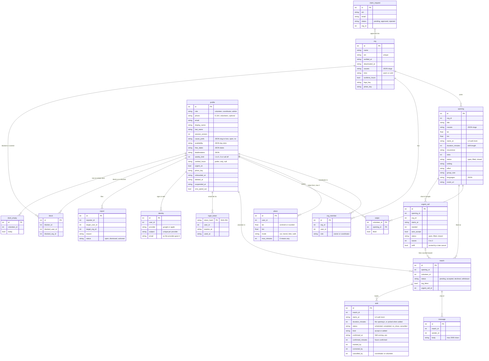

These tables stand on their own:

| Table | Holds |
|---|---|
| `cause` | The four causes (slug, label, icon, sort, active). Openings, orgs and profiles refer to causes by slug inside JSON lists. |
| `photo` | Re-encoded JPEG bytes (`full`, `thumb`) keyed by a random 22-character `key`. `owner_kind` is one of `volunteer`, `org_logo`, `org_photo`, `opening`, with `owner_id` pointing at the matching row. The bytes live in SQLite, so a database backup covers the photos too. |
| `notification` | One row per logical send. `kind` is one of `accepted`, `message`, `likes`, `reminder`, `urgent`, `auto`, `cancel`, `withdrawn`. `key` is unique (for example `accepted:{match}`, `reminder:{shift}`, `urgent:{call}:{volunteer}`, `cancel:{shift}`, `withdrawn:{match}`). `status` is one of `pending`, `sent`, `failed`, `skipped`, `cancelled`, `deferred` (held back by the SMS ceiling) or `unknown` (timed out). This is what makes notices exactly-once and retryable. |
| `rate_event` | One counted action for the persistent rate limits. The key is the limit name plus an HMAC of the phone, email or IP, never the value itself. Rows older than 24 h are pruned. |
| `retained_phone_hash` | An HMAC of a deleted account's phone, kept only when a block, report or suspension must survive deletion, so that it applies again if the number signs up later. |
| `retained_identity_hash` | The same for each Google or Apple account the deleted profile had connected: HMAC-SHA256(`PHONE_HASH_KEY`, "provider:subject"), on the same terms, re-applied when that account signs up or is connected again. A disconnect keeps one too when a block, a report or a suspension stands against the profile. |
| `schema_migrations` | Applied migration versions. |

Notable indexes, created in `app/db.py`:

- `swipe` primary key `(volunteer_id, opening_id)`: one swipe per card.
- `identity_provider_subject` unique: one profile per Google or Apple account.
- `match (opening_id, volunteer_id)` unique: one match per like.
- `notification(key)` unique.
- `shift_match_start_live`: one live shift per match and start time.
- `profile_phone_live`: one live profile per phone.
- `coordinator_email_live` and `admin_email_live`: one live profile per email and role.
- `block_once_v2`: one block per side.

### Migrations

There are two mechanisms (`app/migrations/__init__.py`):

1. **Adding a column or table:** edit the class in `app/db.py`. `db.create(..., transform=True)` reshapes the table at startup. That is the documented rule, and it is enough on its own.
2. **Renames, data changes, index changes on existing tables, and anything involving triggers:** add a numbered module `app/migrations/NNNN_what.py` with `up(conn)`, and also change the class to the end state.

Pending migrations run in order at every start, before the tables are declared. Each runs in its own transaction together with its `schema_migrations` row. A brand-new database records all migrations as applied without running them. You can also run them by hand with `uv run python -m app.migrations [--db PATH]`.

Current migrations:

- `0001_baseline`: a marker only.
- `0002_homelessness_active`: turns the homelessness cause on.
- `0010_cause_prefs`: picked causes become "love".
- `0011_day_slots`: weekday/weekend buckets become day slots.
- `0012_shift_confirmed`: `shift.confirmed_at`, stamped when the volunteer answers "Still coming?" with yes.
- `0013_weekly_limit`: `profile.weekly_limit`, "Up to N shifts a week".
- `0014_shift_length`: `duration_minutes` on `opening` and `shift`. Older rows keep NULL (no length known).
- `0015_confirmed_hours`: `shift.confirmed_minutes`, the hours a coordinator confirmed. Shifts marked before it keep NULL.
- `0016_verified_hours`: `org.confirms_hours` and `profile.verified_hours`. Every org starts as not confirming, every volunteer with no preference.

In practice both have happened. `0012` to `0016` only add columns, yet each is a migration that runs a guarded `ALTER TABLE ... ADD COLUMN` (it does nothing when the column is already there), with the class changed too; nothing records why. Other additions used rule 1 alone: the `identity` and `retained_identity_hash` tables (Google and Apple sign-in) and `profile.match_moment_seen_at` came in by the class change, with no migration. Both ways leave the same table, because a migration runs before `app/db.py` declares the tables and `transform=True` then finds the column already there. So the rule stands: a new column or table needs only the class change, and a migration for it is optional.

---

## 10. Key flows

### Match lifecycle

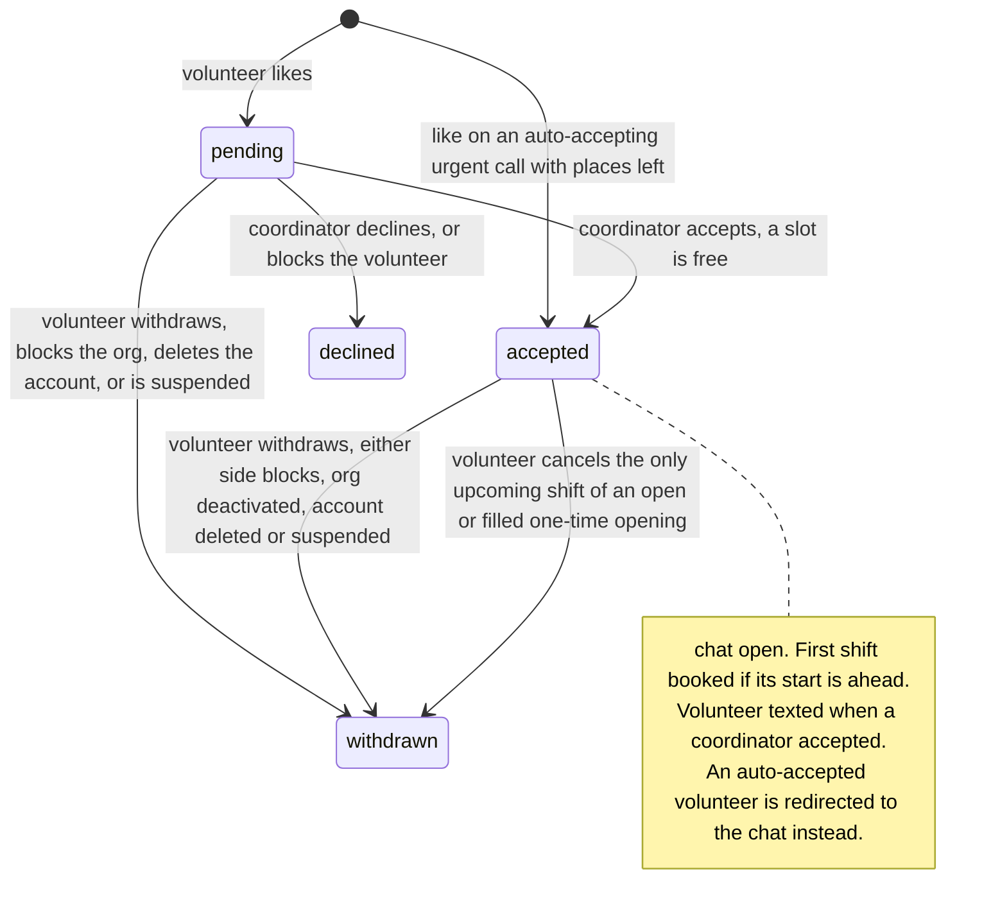

Details the diagram doesn't show:

- An org deactivation turns pending matches into `declined`.
- When a match leaves `accepted`, its future shifts are cancelled and the opening switches back from `filled` to `open` if a slot freed up.
- Closing an opening closes its urgent call and cancels its future shifts. Its matches keep their status.
- When a volunteer withdraws from an accepted match, the org's coordinators get an email (`notify.on_withdrawn`). A pending like leaves the inbox quietly.

### (a) Volunteer sign-in by text code

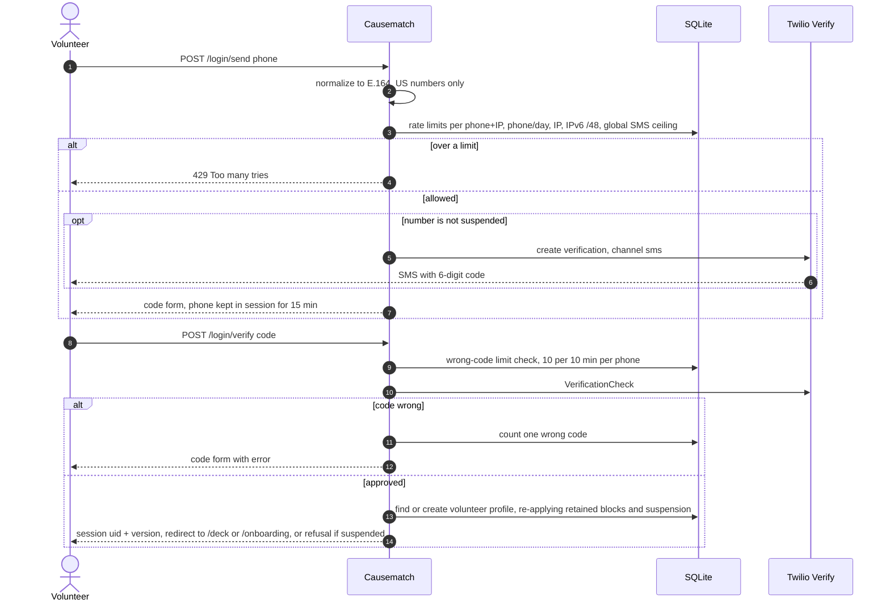

In development, test and preview with `CAUSEMATCH_FAKE_SMS=1`, no text is sent and the code is always `000000`.

### (b) Coordinator or admin sign-in by email link

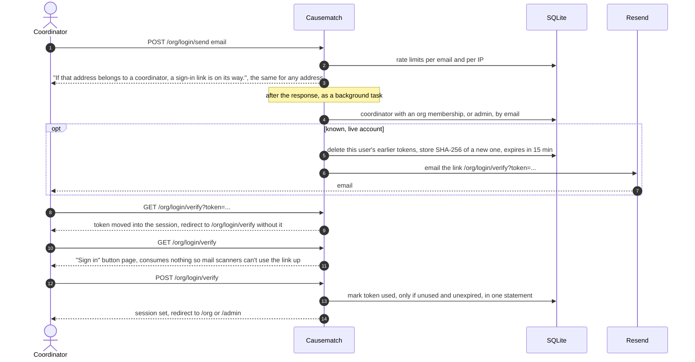

In a preview with the fake emailer, submitting a coordinator's address on `/org/login` shows that coordinator's link on the result page (never an admin's). The demo coordinator's and admin's links are also in the startup log, each valid once for 15 minutes.

### (c) Google or Apple sign-in

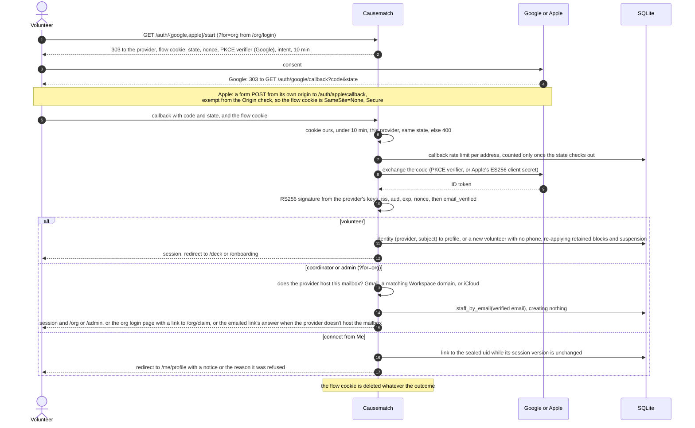

With `CAUSEMATCH_FAKE_OAUTH=1` (development, test, preview) the start redirects to a local consent page, `/auth/fake/consent`, which mints a one-time code bound to the nonce (and the PKCE challenge, for Google) and sends it through the same callback. On a preview the fake never signs in an admin. `docs/OPERATIONS.md` (Security, Sign-in) has the details and the reasons.

### (d) Swipe, like, accept, shift, text, chat

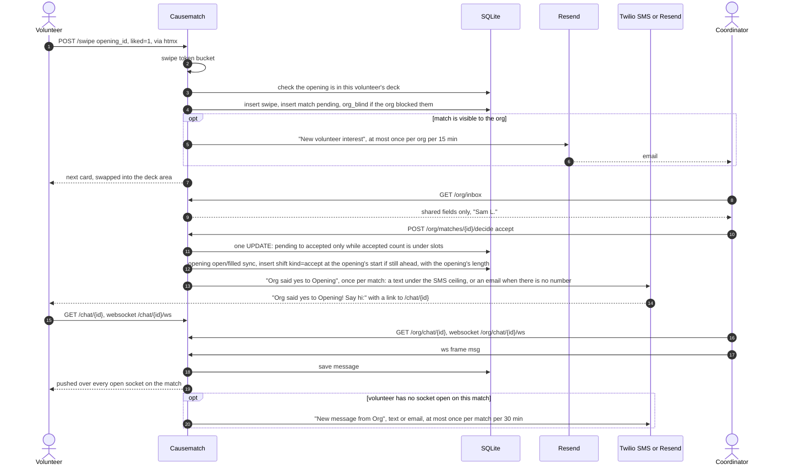

If the accepted match came from a like on an urgent call, the shift is booked at the call's time instead of the opening's. Either way the volunteer's Matches number goes up, and an open deck or Matches page shows the "It's a match!" takeover within about 10 seconds (`GET /deck/news`). If the accept text fails, or is deferred by the SMS ceiling, the reminders task (`POST /tasks/reminders`, planned hourly, not set up) retries it, up to 5 attempts in all. A deferred try doesn't count as an attempt.

### (e) Urgent call: post, notification waves, auto-accept

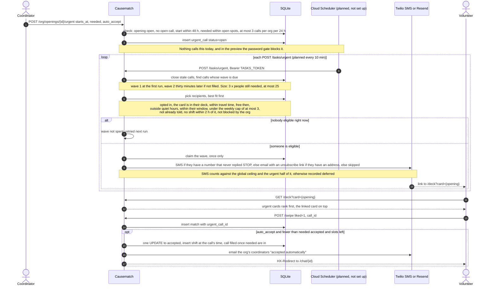

Edge cases:

- If a volunteer likes a card drawn before a call was posted on that opening, nothing is recorded and they are shown the call's card first.
- A like that arrives just after the call filled still counts toward it, but stays pending for the org.
- An urgent email's unsubscribe link `/urgent/off/{volunteer id}-{HMAC}` works signed out. `GET` only shows a page with a button; the `POST` is what turns calls off, so a mail scanner that fetches the link changes nothing. The email also carries a `List-Unsubscribe` header.

### (f) Day-before reminders and retries

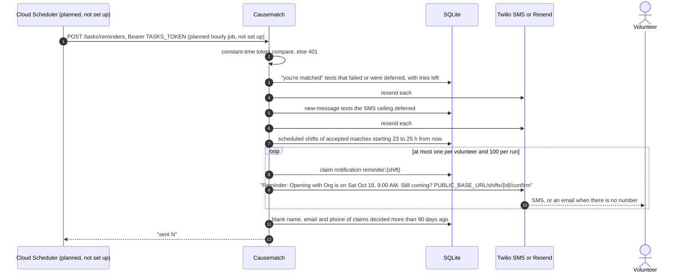

Once an hourly job calls it, the two-hour window puts each shift in at least one run, and the notification key keeps it to one send. No job calls it yet. A shift added less than 23 h before it starts never gets a reminder. The link in the text carries no sign-in token: a signed-out volunteer signs in first. "Yes, I'll be there" stamps `shift.confirmed_at` once, and "Can't make it" leads to the cancel page in (g).

### (g) Can't make this one, and a late cancel's refill

```mermaid
sequenceDiagram
    autonumber
    actor V as Volunteer
    participant A as Causematch
    participant DB as SQLite
    participant R as Resend
    actor C as Coordinator

    V->>A: GET /shifts/{id}/cancel, from Matches, the chat or the Still coming? page
    A->>DB: the volunteer's own upcoming shift on an accepted match, else 404
    A-->>V: confirm page, says whether this gives up the spot
    V->>A: POST /shifts/{id}/cancel, optional reason (300 chars max, never stored)
    A->>DB: shift cancelled, cancelled_by = volunteer
    alt one-time opening, open or filled, and this was its only upcoming shift
        A->>DB: match withdrawn, opening back to open if a slot freed
        opt starts within 48 h, no refill posted for this opening and time before
            A->>DB: urgent_call for 1 person at the shift's time, refill = 1
            Note over A,DB: same rules as a coordinator's call: an open spot, no other open call, 3 a day.<br/>Posted for the coordinator who accepted. Auto-accepts if the org's last call did
        end
    else any other case: recurring, flexible, a closed opening, or other shifts left
        A->>DB: the match stays accepted
    end
    A->>R: email the org's coordinators, once per shift, no volunteer name
    R-->>C: reason, whether a call went out or could be posted, chat link
    A-->>V: redirect to /matches with a notice
```

The reason is never stored: `data.cancel_my_shift` has no column for it, and it goes only into the org's email. A refill is posted once per opening and start time, so a refill's own volunteer cancelling again can't send more texts. Its waves then follow the same rules as any urgent call (section 10e).

### (h) Marking a shift and confirming hours

The rules live in `data.complete_shift`:

- Only a member of the shift's org can mark it, and only once it has started. A cancelled shift can't be marked.
- **Attended** stores `status = completed` and `confirmed_minutes`: the minutes the coordinator picked (one of `choices.SHIFT_HOURS`, 30 minutes to 12 hours in 30-minute steps), or the shift's own `duration_minutes` when they left the choice alone. The page requires hours, so a shift with no length (made before migration `0014`) asks for them.
- Hours above both the shift's length and the time since it started are refused (`HoursRefused`), so nobody confirms 12 hours of a 1-hour shift at its start.
- **No-show** stores `status = no_show` and no hours.
- The first mark stamps `marked_at` and `marked_by`. Marking the same result and hours again changes nothing. A different result, or different hours on an attended shift, is the one correction, allowed within 7 days of the first mark; it stamps `corrected_at` and `corrected_by`.
- `data.my_hours` builds the volunteer's hours: completed shifts with confirmed minutes, grouped by month (newest first) with a total each, and named by the coordinator who last confirmed them (`corrected_by`, else `marked_by`), else the org. Completed shifts with no confirmed minutes are listed apart. A block hides nothing here: it is the volunteer's own record.
- Metrics (`app/metrics.py`) count attended shifts and no-shows, not hours.

---

## 11. Matching and ranking

The deck is built in `app/data.py` from the volunteer's preferences (`app/prefs.py`), and scored by pure functions in `app/match.py`.

```mermaid
%%{init: {"flowchart": {"curve": "basis"}, "themeVariables": {"fontFamily": "Helvetica, Arial, sans-serif"}}}%%
flowchart LR
    all["1. Open openings<br/>starting in the future"] --> f1["2. Hard filters"] --> f2["3. My Only show<br/>choices"] --> f3["4. Session<br/>filter sheet"] --> rank["5. Rank"] --> cards["6. Cards"]

    classDef step fill:#85bbf0,stroke:#5d82a8,color:#0b1f33
    classDef key fill:#438dd5,stroke:#2e6295,color:#ffffff
    class all,f1,f2,f3,rank step
    class cards key
```

1. **Open openings** whose start is still ahead (an opening with an open urgent call is judged at the call's time).
2. **Hard filters**, always on: a verified, active org the volunteer hasn't blocked; at least one active cause; not swiped yet; no cause marked "not for me"; a separate orientation only if the volunteer said that's fine; within the volunteer's horizon (how far ahead they look), or 48 hours in today mode ("Next 48h").
3. **Only show choices** (dealbreakers), each only when picked:
   - distance: within some place's travel time (on by default);
   - causes: only loved or open ones;
   - when: free then, or a flexible opening, and one-time/recurring fits (not applied in today mode);
   - work: no contradicting setting, effort or group size;
   - verified hours set to Only show: only orgs that confirm hours.
4. **The session filter sheet**: the main place's travel time (only while distance is a dealbreaker; it can widen or narrow it), hidden causes, this week only.
5. **Rank**: a week already at the weekly limit last, then urgent calls first, then fit score, then soonest. Today mode ranks soonest, then nearest.
6. **Cards**: the linked card (from an urgent call's text) on top. With "Surprise me", about 1 in 8 comes from outside the loved causes (it needs a loved cause, is off in today mode, and never replaces an urgent top card). Each card has 1 to 4 why-chips and the travel minutes.

**Places and travel time.** A volunteer helps from at most 2 places. A place's point is either a ZIP or neighborhood centroid, or a device location rounded to 2 decimals (about 1 km) and checked to fall within a box around LA County. There's no routing API: travel minutes are the straight-line (haversine) distance divided by a door-to-door speed for the mode (car 32 km/h, transit 14, bike 13, walk 4.5). A place's reach is `max_minutes × speed`, and 0 means any distance. Each card is measured from whichever place gives the quickest trip. Remote openings skip distance entirely.

**Fit score** (`app/match.py`) is a weighted sum where each term is between 0 and 1:

| Term | Weight | How it's computed |
|---|---|---|
| Causes | 0.30 | Each of the opening's causes counts 1.0 if loved and 0.6 if open, divided by the size of the union of its causes and the volunteer's loved causes. |
| Distance | 0.18 | 1 at the place, falling linearly to 0 at the place's reach (60 km for "any"). Remote openings score 1. |
| Availability | 0.15 | 1 if the start falls in a ticked day slot or on a free date, 0.5 for a flexible opening, else 0. Halved if one-time/recurring doesn't fit. |
| Skills | 0.12 | The share of the opening's skills the volunteer has. 0.5 when the opening asks for none. |
| Work | 0.10 | Mean of four terms. Setting, effort and group size each score 1 if they agree, 0 if they differ, 0.5 if either side doesn't say. First-timer scores 1 when the volunteer asked for it and the opening is, else 0.5. |
| Reply rate | 0.10 | The org's share of eligible matches decided within 48 h. 0.5 with no history. |
| Language | 0.05 | 1 if the volunteer speaks a language the opening says helps, else 0.5. A language is never required. |

When the volunteer set "Nonprofits that confirm my hours" to Prefer, the score is blended once more in `app/data.py` (`_fit`, `VERIFIED_WEIGHT = 0.15`): `fit × 0.85 + 0.15` for an org that confirms hours, `fit × 0.85` for one that doesn't. A volunteer who speaks a language besides English counts as having the "language" skill when an opening asks for it.

**Weekly limit.** "Up to N shifts a week" (off, stored as 0 or NULL, or 1 to 5, `app/prefs.py` `weekly_limit`) counts the volunteer's shifts that aren't cancelled in each Los Angeles week, Monday to Sunday. In a week that is already full, the deck ranks that week's openings after every other week's and marks them "Your week is full", and urgent waves skip the volunteer for calls in that week.

**Why-chips** explain each card, most telling first: up to two cause chips (♥ for loved), then "Surprise pick", "Remote", "You're free that day" or "You're free Sat mornings", first-timer friendly (here only if the volunteer asked for it), matching kinds of work, "Spanish helps"-style language chips, and last, first-timer friendly when the volunteer didn't ask for it. Normal cards show up to 4 chips. Urgent cards show 2, because their badge ("Urgent · tomorrow 9 am · needs 2") and an optional "Like and you're booked" line take the room. Three chips keep their place by pushing out the last ordinary reasons, so a card still shows at most 4 (2 when urgent): "You're booked at {org} then" when the card starts less than 4 hours (`CLASH_HOURS`) from a shift the volunteer already has, "Confirms your hours" for an org that does (the one that gives way when they don't all fit), and "Your week is full". An urgent card with a clash and a full week shows only those two.

**Empty deck.** Empty views are logged into `deck_empty` for the metrics, at most once per volunteer per hour, with today mode counted separately. The empty state offers the single change that would add the most cards: widen a place's travel time, look further ahead, drop one dealbreaker, show nonprofits that don't confirm hours (when verified hours is set to Only show; it becomes Prefer), or clear the filter sheet.

The same visibility check guards `POST /swipe`, so a like sent by id for an opening the volunteer couldn't see is refused. The same fit score orders who gets an urgent call's notices.

---

## 12. Security and privacy

### Who sees what, and when

| Data | Who sees it |
|---|---|
| Volunteer's phone, email, places, coordinates, connected Google or Apple accounts | Nobody else. Coordinates are never rendered, and cards show only the travel minutes from the nearest place. (`data._distance_label` computes whole miles, but the card shows them only when there is no travel time, and with a place both are set, so in practice miles never appear: `app/routes/deck.py`, `place_line`.) |
| Match preferences (cause ratings, dealbreakers, free dates, weekly limit, the verified-hours choice, last-minute settings) | Only the volunteer. Nothing records why a volunteer wants nonprofits that confirm hours. |
| What the volunteer shares (`SHARED_WITH_NONPROFIT` in `app/choices.py`): photo, first name and last initial, pronouns, bio, interests, causes (A to Z, without saying which are loved), general availability (weekday/weekend × part of day), languages, frequency, neighborhood | A nonprofit, only after the volunteer likes one of its openings. The inbox query selects only these columns. |
| Full last name | The nonprofit, once it accepts. |
| A shift's confirmed hours and "Still coming?" answer | The volunteer, and the coordinators of the shift's org. |
| The reason given when cancelling a shift | Never stored. It goes only into the email to the org's coordinators, which doesn't name the volunteer. |
| Whether an org confirms volunteer hours | Volunteers, as the "Confirms your hours" chip on its cards. Only the org's members can change it. |
| A volunteer's photo (`/photos/{key}.jpg`, `/photos/thumb/{key}.jpg`) | The volunteer, admins, and coordinators of an org whose inbox shows one of their matches, with no block either way. Anyone else gets 404, the same as for a missing photo. It's always revalidated (`private, no-cache`), so a block or removal hides it at once. |
| Org logo and photos, opening photos | Anyone signed in. These may be cached for a day. |
| After a block, either way | The volunteer's waiting and decided rows leave the org's inbox. Past matches and shifts stay, labelled only "Volunteer", with no photo or details. A like from a volunteer the org blocked looks normal to the volunteer but never reaches the org (`org_blind`). |
| Pilot metrics | Admins only. Aggregates, small groups merged, no names, phones or emails. |

### Photo pipeline (`app/photos.py`, `app/photo_worker.py`)

```mermaid
flowchart LR
    up["Upload POST, up to 6 MB<br/>photo.js shrinks it in the browser to 1600 px first, logos excepted"] --> bucket["upload bucket<br/>10, then 1 a minute"]
    bucket --> check["Header checks in the app<br/>format JPEG, PNG, WebP, GIF<br/>pixel caps: JPEG 50 MP, WebP 8 MP, PNG/GIF 12 MP<br/>JPEG marker walk: max 50 scans, coefficient budget"]
    check --> slot["one of 2 decode slots<br/>wait up to 5 s, else Busy"]
    slot --> child["python -I app/photo_worker.py<br/>env PATH and LANG only, no secrets<br/>no core dumps, RLIMIT_CPU 8 s<br/>Linux: RLIMIT_AS 512 MB<br/>killed after 10 s or 4 MB output"]
    child --> out["fresh JPEGs, no EXIF or GPS<br/>full + 160 px thumb"]
    out --> store[("photo table<br/>random 22-char key")]
```

The child process runs as the same user as the app: it limits resources but doesn't drop privileges. macOS doesn't enforce `RLIMIT_AS`, so in development only the CPU limit and the timeout apply. CI checks that the memory cap really runs on Linux.

### Request-level defences (`app/security.py`)

- **Same-origin writes.** Every unsafe method needs `Origin` equal to `PUBLIC_BASE_URL`'s origin or, when the browser sends no `Origin`, a `Referer` on it. The only exemptions are `/tasks/reminders`, `/tasks/urgent` and `/auth/apple/callback`, which Apple posts from its own origin and which acts only with a flow cookie whose state matches (10c). Websockets need the exact `Origin`.
- **Headers on every response:**
  - A CSP of `default-src 'self'`, `script-src 'self'`, `style-src 'self'` with no inline code, `img-src 'self' data: blob:`, `connect-src 'self'` plus the ws origin, `font-src 'self'`, `frame-ancestors 'none'`, `base-uri 'self'`, `form-action 'self'` plus `https://accounts.google.com` and `https://appleid.apple.com` (Me's Connect form answers with a redirect to them) and `object-src 'none'`.
  - `X-Frame-Options: DENY`, `nosniff`, `strict-origin-when-cross-origin`.
  - A permissions policy that allows geolocation only on `/onboarding`, `/me/preferences` and `/me/preferences/causes`.
  - `Cache-Control: no-store`, except on `/static` and `/favicon.ico`, unless the route sets its own (photos do).
  - HSTS in production and preview.
  - `X-Robots-Tag: noindex, nofollow` in preview.
- **Body limits:** 64 KB, or 6 MB on photo upload paths. Over that, 413.
- **Errors in production:** a plain 500 page with a reference id. The log line keeps the request id and stack frames but not the exception message, which could hold a phone number. The uvicorn access log redacts `token`, `access` and `code` in query strings (`security.REDACTED`), and the logs mask phones and emails.
- **Client IP:** taken from `X-Forwarded-For`, exactly `TRUSTED_PROXY_HOPS` places from the right. IPv6 clients are counted per /64.

Rate limits fall into two kinds:

| Kind | Limits |
|---|---|
| Persistent, stored in `rate_event` so a restart doesn't reset them | **Sign-in codes:** 5 per 10 min and 10 per day per (phone, IP); 20 per day per phone; 60 per hour per IP; 120 per hour per IPv6 /48. **Wrong codes:** 10 per 10 min per phone. **Email links:** 5 per hour per email, 20 per hour per IP. **Google and Apple callbacks:** 30 per 10 minutes per IP, counted once the flow cookie and state check out. **Adding a phone from Me:** the sign-in code limits. **Demo sign-ins** (a demo only): 10 demo volunteers per hour per IP, also counted against the IP's sign-in code limits; the one-tap nonprofit demo counts against the email-link limit per IP. **Claims:** 5 per hour per IP, 3 per day per email. **ProPublica calls:** 30 per hour across all admins; the claim page's name search has its own, 60 per hour per IP and 300 per hour for every visitor together. **SMS ceiling** on every text: `SMS_MAX_PER_HOUR` (default 100) and `SMS_MAX_PER_DAY` (default 500). Urgent waves may use only half of each, so sign-in codes always have room. |
| In-memory token buckets per user | Swipe: 30, then 1 per second. Chat: 20, then 2 per second. Report/block: 10, then 1 every 6 minutes. Uploads: 10, then 1 per minute. Wrong preview keys, cookies and passwords: 10 per client address, then 1 per minute. |

HTTP requests over a limit get a 429 page with `Retry-After` (600 s for the persistent limits). Chat frames over the bucket close the socket with 1013. Texts over the SMS ceiling are deferred. A reporter may also file at most 10 reports in any 24 hours, counted from the `report` table; the 11th is refused on the form.

### Preview gate

When `CAUSEMATCH_ENV=preview` and `PREVIEW_PASSWORD` has at least 16 characters, `PreviewGate` lets a request through only with the access cookie or the password by HTTP Basic auth, on every request: pages, `/static`, `/photos`, `/tasks` and websocket handshakes, so in a preview nothing can call `/tasks/*` (see section 13). The link people are sent carries the password as `?access=`. On a top-level navigation (`Sec-Fetch-Dest: document` with `Sec-Fetch-Mode: navigate`, or no Sec-Fetch headers, as from curl) a GET with the right key gets a 303 to the same URL without the key and the cookie `__Host-cm_preview` (Secure, HttpOnly, SameSite=Lax, 30 days). Any other request with `?access=` is refused without weighing the key, so a foreign page's `` can't use up a visitor's guesses; a browser that has the cookie just gets the 303 without the key. The cookie is `<issue time>.<mac>`, the mac an HMAC-SHA256 keyed with `SESSION_SECRET` over a label, the password's SHA-256 and the issue time: it can't be made without the secret, expires after 30 days on the server side too, and a new password (or session secret) voids every one. Basic auth (any user name) stays for scripts. The password is compared in constant time on SHA-256 digests. Anything else gets a plain 401 page with no `WWW-Authenticate`, so browsers show no dialog; websockets are closed with 1008. Wrong keys, cookies and passwords share the per-address limit above. Only `/robots.txt` answers without it, with `Disallow: /`.

### Secrets and what never enters git

- **Secrets come from the environment**, through Secret Manager on Cloud Run: `SESSION_SECRET`, `PHONE_HASH_KEY`, `TASKS_TOKEN`, `PREVIEW_PASSWORD`, Twilio and Resend keys, `GOOGLE_CLIENT_SECRET` and `APPLE_PRIVATE_KEY`. In production the first three and the Google secret must be at least 32 characters.
- **`PHONE_HASH_KEY`** keys several HMACs: rate-limit keys, retained phone and identity hashes after deletion, and urgent unsubscribe links.
- **Excluded by `.gitignore`:**
  - `data/`, `*.db`
  - `.env*`, except `.env.example`
  - screenshots
  - `preview-seed/`, the real-nonprofit seed copied in only for a preview build; `.gcloudignore` re-includes it for Cloud Build
  - agent files (`.omc/`, `CLAUDE.md`, `.claude/`)
- **Secret scanning:** `scripts/secret_scan.sh` runs gitleaks over the whole history. Locally it skips when gitleaks isn't installed; in CI a missing gitleaks fails the job.
- **Seed safety:** `scripts/deploy_preview.sh` refuses to copy the seed if `preview-seed/` is tracked or not ignored.
- **Account deletion** (`data.delete_account`) soft-deletes the profile (`deleted_at`) and ends every session. It:
  - **deletes** the volunteer's places, login tokens, connected Google or Apple identities and photos;
  - **sets to NULL** on the profile: `phone`, `email`, `display_name`, `last_name`, `contact_phone`, `lat`, `lon`, `neighborhood`, `other_causes`, `language_other`, `free_dates`, `verified_hours`, `pronouns`, `bio`, `interests` and `photo_key`;
  - **withdraws** pending and accepted matches (cancelling their future shifts), replaces the volunteer's messages with "[message removed]", and cancels their pending and failed notices;
  - **keeps** a keyed hash of the phone and of each identity only when a block, report or suspension must survive (see section 9);
  - **leaves on the deleted row** every other column, including the preference answers: `causes`, `cause_prefs`, `availability`, `dealbreakers`, `weekly_limit`, `skills`, `languages`, `setting`, `effort`, `group_size`, `first_timer`, `orientation_ok`, `horizon_days`, `commitment`, `surprise`, `frequency`, `radius_km`, the `urgent_*` settings, `heard_from` and `volunteered_last_year`. Nothing on that row names the person any more. The metrics read only `heard_from` from it (`app/metrics_rows.py`). The `delete_account` docstring says more is cleared ("every personal column scrubbed, kept: the answers the metrics group by"); this list is what the code does.

---

## 13. Environments and deploy

`CAUSEMATCH_ENV` must be declared. With it unset, the app refuses to start unless it is on Cloud Run (`K_SERVICE` set), which always counts as production. A preview is production plus a password gate and a few demo allowances (`app/config.py`).

| | development / test | preview | production |
|---|---|---|---|
| Set by | `CAUSEMATCH_ENV=development` or `test` | `CAUSEMATCH_ENV=preview` + `PREVIEW_PASSWORD` (16+ chars) | `CAUSEMATCH_ENV=production`, or Cloud Run |
| Production rules (strong secrets, https origin, `__Host-` cookie, HSTS, plain 500 page) | no | yes | yes |
| Session secret | public dev default if unset | required, 32+ chars | required, 32+ chars |
| Fake SMS (code `000000`) and fake email (logged) | allowed with `CAUSEMATCH_FAKE_SMS=1` / `CAUSEMATCH_FAKE_EMAIL=1` | allowed, and set by the deploy script | refused at startup |
| Fake Google and Apple consent page | allowed with `CAUSEMATCH_FAKE_OAUTH=1` (set by the tests and `scripts/demo.py`) | allowed, and set by the deploy script | refused at startup |
| Volunteer sign-in providers | none required | at least one of Twilio Verify (the fake counts), Google, Apple | at least one of Twilio Verify, Google, Apple |
| Password on every request | no | yes, `PreviewGate` | no |
| Banner on every page | only with `CAUSEMATCH_DEMO_BANNER=1` (`scripts/demo.py --seed-file`) | always ("Preview") | refused at startup |
| Demo matches: a fresh demo volunteer per sign-in with `(310) 555-0100` or the "Try it as a volunteer" button, a "Try it as a nonprofit" button, and stand-in coordinators that accept a like after a few seconds | with `CAUSEMATCH_DEMO_MATCHES=1` (`scripts/demo.py`) | with `CAUSEMATCH_DEMO_MATCHES=1`, set by the deploy script | refused at startup |
| Seeding | invented orgs from `app/db.py` into an empty database (verified in dev and test) | `app/demo_seed.py` into an empty database at each cold start: `PREVIEW_SEED_DIR`, else the invented orgs, plus demo people | none |
| Coordinator sign-in link | emailed by the fake, i.e. logged | shown on the `/org/login` result page for a coordinator's address (never an admin's); demo coordinator and admin links in the startup log | emailed by Resend |

Local options:

- `uv run python main.py`: run the app.
- `uv run python scripts/demo.py [--seed-file PATH]`: a throwaway database with demo data. It prints how to sign in as each role and refuses production.
- `scripts/screenshots.py --out DIR`: screenshot every page of the demo.
- `scripts/video/make_demo_video.sh`: re-record the narrated demo video for the website (steps in `scripts/video/README.md`).
- `scripts/build_site.sh [DIR]`: assemble the public website (`site/` plus shared assets) into `_site/`.

### What is live and what is planned

Based on the code and config in this repo:

| Piece | Status |
|---|---|
| Cloud Run preview (`causematch-preview`, `us-west1`) | **Live.** Password-protected, deployed by `scripts/deploy_preview.sh`. |
| SQLite file | **Live**, but in the preview it lives inside the container and is reseeded at each cold start. |
| Photo worker child process | **Live** (`app/photo_worker.py`). |
| ProPublica API | **Live.** Used by the claim page's name search, the admin orgs and claims pages and by `scripts/import_orgs.py` / `scripts/verify_org.py`. |
| Secret Manager | **Live** for the preview: `PREVIEW_PASSWORD`, `SESSION_SECRET`, `PHONE_HASH_KEY`, `TASKS_TOKEN`. |
| Twilio Verify and SMS, Resend email | **Implemented** (`app/notify.py`), **not live**. The preview runs the fakes (`CAUSEMATCH_FAKE_SMS=1`, `CAUSEMATCH_FAKE_EMAIL=1`). Production refuses to start without Resend, and Twilio is optional once Google or Apple is set: without it there is no phone sign-in and volunteers get email instead of texts. |
| Google and Apple sign-in | **Implemented** (`app/oauth.py`, `app/routes/oauth.py`), **not live**. The preview and `scripts/demo.py` run the fake (`CAUSEMATCH_FAKE_OAUTH=1`), a local consent page. Production refuses to start with none of Twilio Verify, Google and Apple, or with any of them half set. Setup is in `docs/OPERATIONS.md`, Live providers. |
| Cloud Scheduler calling `/tasks/reminders` and `/tasks/urgent` | **Not set up.** The endpoints exist and check a bearer token (`app/routes/tasks.py`), but nothing calls them: the Cloud Scheduler API isn't enabled in the project, and no script creates the jobs `docs/OPERATIONS.md` describes. In the preview they can't be called at all, because `PreviewGate` and the bearer check both read the one `Authorization` header. So the preview sends no day-before reminders, no accept-text retries and no urgent waves (the demo seed sends one wave directly). |
| Litestream to GCS | **Planned.** Mentioned only in a code comment (`app/db.py`, `Photo`). No configuration exists in the repo. |
| Public website on GitHub Pages | Published by `.github/workflows/pages.yml` on pushes to `main` that touch `site/` or its assets. A static page with the demo video; it doesn't talk to the app. |

The app runs as a single process whose state is local to the instance: the SQLite file on the container's disk, plus in memory the open chat sockets (`app/routes/chat.py`) and the token buckets (`app/security.py`). The preview deploy caps the service at one instance (`--max-instances 1`). Nothing sets that cap for production, which would need it (or shared state).

### Container and preview deploy

```mermaid
flowchart LR
    dev["Developer machine<br/>scripts/deploy_preview.sh"] -- "checks project is named Causematch<br/>copies seed into ignored preview-seed/" --> cb["Cloud Build<br/>gcloud run deploy --source ."]
    cb -- "Dockerfile" --> img["Image in Artifact Registry<br/>python:3.12-slim + uv, pinned by digest<br/>uv sync --frozen --no-dev<br/>non-root user owns only data/"]
    img --> svc["Cloud Run service causematch-preview<br/>us-west1, 0 to 1 instances, 1 GiB, 1 CPU<br/>--allow-unauthenticated, the app gates itself"]
    sm["Secret Manager<br/>PREVIEW_PASSWORD, SESSION_SECRET,<br/>PHONE_HASH_KEY, TASKS_TOKEN"] --> svc
    svc -- "second step: set PUBLIC_BASE_URL<br/>to the service URL" --> svc
```

- **`Dockerfile`:** the image's `CMD` runs uvicorn with the `Procfile`'s flags (`--ws-max-size 65536`, `--limit-concurrency 200`, `--timeout-keep-alive 15`, `--timeout-graceful-shutdown 8`, `--no-proxy-headers`) on `$PORT`, default 8080.
- **`scripts/deploy_preview.sh`** sets `CAUSEMATCH_ENV=preview`, `PREVIEW_SEED_DIR=/app/preview-seed`, `TRUSTED_PROXY_HOPS=1`, the three fakes (SMS, email, Google and Apple), `CAUSEMATCH_DEMO_MATCHES=1`, `CONTACT_EMAIL` and `PUBLIC_BASE_URL`. The seed also ends up in the Cloud Build source bucket and in the image. Both are private to the project.
- **Production is not deployed yet.** The code expects these additions:
  - real Resend credentials, and at least one of Twilio, Google and Apple (`docs/OPERATIONS.md`, Live providers)
  - a persistent database (Litestream replication to GCS is the plan)
  - the two Cloud Scheduler jobs (`/tasks/reminders` hourly, `/tasks/urgent` every 10 minutes): the API is not enabled in the project and no script creates them. A preview would also need a way past `PreviewGate` for them, since the gate and the bearer check share the `Authorization` header.
  - at least 1 GiB of memory, for two worst-case photo decodes at once

### Environment variables

| Name | Purpose | Required |
|---|---|---|
| `CAUSEMATCH_ENV` | `development`, `test`, `preview` or `production` | always, except on Cloud Run |
| `SESSION_SECRET` | Signs the session cookie | production, preview (32+) |
| `PUBLIC_BASE_URL` | The app's origin: emailed links, the same-origin check, CSP. Never read from the request. | production, preview (`https://`, origin only); dev defaults to `http://localhost:5001` |
| `TASKS_TOKEN` | Bearer token for `/tasks/*` | production, preview (32+) |
| `PHONE_HASH_KEY` | HMAC key: rate-limit keys, retained phone hashes, unsubscribe links | production, preview (32+) |
| `CONTACT_EMAIL` | Address on `/privacy` and in claim emails | production, preview |
| `TRUSTED_PROXY_HOPS` | Proxies appending to `X-Forwarded-For`: 1 for `*.run.app`, 2 behind a load balancer | on Cloud Run |
| `TWILIO_ACCOUNT_SID`, `TWILIO_AUTH_TOKEN`, `TWILIO_VERIFY_SID` | Sign-in codes | all four Twilio variables or none; production needs Twilio, Google or Apple |
| `TWILIO_FROM_NUMBER` | Sender of notification texts | with the other three |
| `GOOGLE_CLIENT_ID`, `GOOGLE_CLIENT_SECRET` | Google sign-in | optional; both or neither (secret 32+ in production) |
| `APPLE_CLIENT_ID`, `APPLE_TEAM_ID`, `APPLE_KEY_ID`, `APPLE_PRIVATE_KEY` | Sign in with Apple: Services ID, team, key id, the `.p8` key's PEM | optional; all four or none; https only |
| `EMAIL_API_KEY`, `EMAIL_FROM` | Resend | unless `CAUSEMATCH_FAKE_EMAIL=1` |
| `PREVIEW_PASSWORD` | The preview's access key (`?access=` link) and HTTP Basic password | preview (16+) |
| `PREVIEW_SEED_DIR` | Folder with `orgs.json`, `logos-raw/`, `photos-raw/` | optional, preview |
| `CAUSEMATCH_FAKE_SMS`, `CAUSEMATCH_FAKE_EMAIL` | `1` = fakes | optional; dev, test, preview only |
| `CAUSEMATCH_FAKE_OAUTH` | `1` = a local consent page stands in for Google and Apple | optional; dev, test, preview only |
| `CAUSEMATCH_DEMO_BANNER` | `1` = demo banner (set by `scripts/demo.py --seed-file`) | optional; refused in production |
| `CAUSEMATCH_DEMO_MATCHES` | `1` = a fresh demo volunteer per sign-in with the demo number, and stand-in coordinators that accept likes (set by `scripts/demo.py` and the preview deploy) | optional; dev, test, preview only |
| `CAUSEMATCH_DB` | SQLite path, default `data/causematch.db` | optional |
| `SMS_MAX_PER_HOUR`, `SMS_MAX_PER_DAY` | Global SMS ceiling, defaults 100 / 500 | optional |
| `CAUSEMATCH_LOG_LEVEL` | `DEBUG` adds a hashed client key per limited request | optional |
| `PORT`, `K_SERVICE` | Set by Cloud Run | n/a |

`.env.example` lists the variables without values. `CAUSEMATCH_DEMO_BANNER` and `CAUSEMATCH_DEMO_MATCHES` are read in `app/config.py` but aren't listed there.

---

## 14. Testing and CI

| Part | What it covers |
|---|---|
| `tests/conftest.py` | Before importing the app it sets `CAUSEMATCH_ENV=test`, a temporary `CAUSEMATCH_DB`, the three fakes (SMS, email, Google and Apple) and `PUBLIC_BASE_URL=https://causematch.test`. It replaces Starlette's `TestClient` with one that sends the same `Origin` a browser would, and provides fixtures for fresh databases and signed-in volunteers and coordinators. The `live_url` fixture runs the real app under uvicorn in a thread on a free port, for browser tests. |
| `tests/test_*.py` (34 modules) | One module per area: access and roles, auth, Google and Apple sign-in (`test_oauth.py`, `test_oauth_apple.py`, through the fake consent page and with test-generated signing keys), cookie settings, org auth, claims, deck, matching (`test_match*.py`), prefs, onboarding, openings, urgent calls, shifts (marking, confirmed hours, cancel and confirm pages), My hours (`test_hours.py`), chat and threads, notify, safety, security, preview, photos, org media, profile, metrics, import, db and migrations, PWA, UI, and the public website (`test_site.py`). |
| `tests/e2e/` | Playwright with Chromium, often at iPhone 13 size, against `live_url`: swipe and drag, live chat between two browsers, the match moment arriving live, the deck fitting one screen, preferences, photo upload, layout and tap targets. Marked `e2e`. |
| `tests/fixtures/propublica/` | Recorded ProPublica API responses, so tests never call the network. |

`pyproject.toml` sets a 300 s per-test timeout (`pytest-timeout`) and the `e2e` and `perf` markers.

CI (`.github/workflows/ci.yml`) runs on pushes to `main` and on pull requests, on `ubuntu-latest`, in this order:

```mermaid
flowchart LR
    a["checkout<br/>full history"] --> b["uv sync --frozen<br/>playwright install chromium"]
    b --> c["Lint<br/>ruff check<br/>ruff format --check"]
    c --> d["Secret scan<br/>gitleaks 8.21.2, checksum-verified<br/>scripts/secret_scan.sh"]
    d --> e["Tests<br/>pytest -q -rs<br/>unit, integration and e2e"]
    e --> f["Photo worker memory cap<br/>the two RLIMIT tests must pass,<br/>not skip, on Linux"]
```

A second workflow, `.github/workflows/pages.yml`, only assembles and publishes the website.

---

## 15. Where to go next, and a glossary

### Where to go next

- **New to the code:** read Part 1 first, then `main.py`, then `app/auth.py` and `app/security.py`, then one vertical slice. A good one is `app/routes/deck.py`, then the deck functions in `app/data.py`, then `app/match.py`.
- **Changing the schema:** see section 9 and the docstring in `app/migrations/__init__.py`.
- **Adding a POST route:** it gets the same-origin check automatically. Add the route to `PUBLIC` in `app/auth.py` only if it must work signed out. A new upload path needs an entry in `security.UPLOADS`, and a new scheduler path needs `ORIGIN_EXEMPT` plus its own bearer-token check.
- **Adding Tailwind classes:** run `scripts/build_css.sh` and commit `static/vendor/app.css`.
- **Operations:** see `docs/OPERATIONS.md` (configuration, scheduled jobs, security notes, preview deploy) and `scripts/`.

### Glossary

| Term | Meaning |
|---|---|
| **Opening** | A volunteering opportunity a nonprofit posts: title, cause, place, next start time, shift length, recurrence, slots. Status is `open`, `filled` (accepted matches reached slots) or `closed`. |
| **Card / deck** | The volunteer's ranked stack of openings, shown one card at a time. |
| **Swipe** | A Like or Pass on a card. There is one per volunteer and opening, and a card never comes back. |
| **Like** | A swipe right. It creates a pending match. |
| **Match** | A like and its outcome: `pending`, `accepted`, `declined` or `withdrawn`. |
| **Accept** | The coordinator's yes. It books the first shift (when its start is still ahead), texts the volunteer and opens the chat. |
| **Shift** | One dated occurrence of volunteering on an accepted match, with its own length. Status is `scheduled`, `completed` (attended), `no_show` or `cancelled`. The first is created on accept (`kind=accept`), and later ones are added by the coordinator (`kind=added`). |
| **Shift length** | How long a shift lasts (`duration_minutes`, 1 to 8 hours), set on the opening and copied to each shift, or picked by the coordinator when adding one. Old rows have none. |
| **Still coming?** | The day-before reminder's question. A yes stamps `shift.confirmed_at`, and the coordinator sees "Confirmed". |
| **Can't make this one** | A volunteer cancelling one upcoming shift. The match stays, except for the only shift of a one-time opening. |
| **Refill** | The urgent call for 1 person the app posts itself when a late cancel gives up a spot (`urgent_call.refill`). |
| **Confirmed hours** | The hours a coordinator stored when marking a shift attended (`shift.confirmed_minutes`). They add up on the volunteer's Shifts and hours page. |
| **Verified hours** | A volunteer's private choice about nonprofits that say they can confirm hours (`org.confirms_hours`): no preference, Prefer or Only show (`profile.verified_hours`). |
| **Weekly limit** | "Up to N shifts a week". A full week's openings rank last and its urgent calls skip the volunteer. |
| **Clash warning** | The "You're booked at {org} then" chip on a card that starts less than 4 hours from a booked shift. |
| **Messages to answer** | Accepted chats whose latest message is the volunteer's. They head the org's inbox and count in its Inbox badge. |
| **Urgent call / last-minute call** | "Need N more for this shift in the next 48 hours" on an open opening. It triggers notification waves and can auto-accept likes. |
| **Wave** | One batch of urgent notifications. There are at most 2 per call, 30 minutes apart. |
| **Auto-accept** | An urgent call option where the first N likes are accepted without a coordinator decision. |
| **Cause rating** | Love, open, or not for me, per cause. "Not for me" always hides. |
| **Dealbreaker** | A preference set to "Only show", which hides non-fitting openings instead of only ranking them lower. Distance is on by default. |
| **Place** | Where a volunteer helps from (max 2), with a travel mode and max minutes. It is never an address. |
| **Fit score** | The weighted 0 to 1 score that orders the deck and urgent recipients (section 11). |
| **Why-chip** | A short reason on a card ("♥ Animal shelters", "You're free Sat mornings"). |
| **"Next 48h"** | Deck mode limited to shifts starting within 48 hours, sorted soonest first. The code calls it today mode. |
| **Surprise me** | About one card in 8 comes from outside the volunteer's loved causes. |
| **Filter sheet / view** | Temporary deck filters kept in the session, separate from saved preferences. |
| **Coordinator / owner** | A nonprofit staff member with membership in an org. The owner is the first approved claimant. |
| **Claim** | A public request to manage an org, decided by an admin. |
| **Verified org** | An org whose EIN an admin checked. Only verified, non-deactivated orgs appear in decks. |
| **Org-blind like** | A like from a volunteer the org blocked. It's recorded but never shown to the org. |
| **Preview** | The password-protected Cloud Run deploy with demo data and fake SMS and email. |
| **Session version** | A counter on the profile. Bumping it signs out every device. |
| **Identity** | A volunteer's Google or Apple account, known by the provider's subject id, never by its email. Coordinators and admins have none: their provider sign-in creates nothing. |
| **Flow cookie** | `__Host-cm_oauth` (`cm_oauth` in development): the signed, 10-minute cookie that carries one Google or Apple sign-in from start to callback. |
| **Match moment** | The "It's a match!" takeover, which arrives live through `GET /deck/news`. |
| **Horizon** | How far ahead a volunteer looks for openings: this week, 2 weeks, a month or any time. |
| **Token bucket** | A per-user rate limit kept in memory: a burst allowance that refills at a steady rate. |
| **SMS ceiling** | The global hourly and daily cap on texts. Notifications over it are deferred, and urgent waves get half of it. |
