# Causematch: architecture and features

This document is for two readers: a developer joining the project, and a technically minded partner who wants to know what the app does. Sections 1 and 2 cover features and the overall shape. Later sections go down into requests, modules, data, flows and operations. File paths are relative to the repo root.

Contents:

1. [What Causematch is](#1-what-causematch-is)
2. [System context](#2-system-context)
3. [Request pipeline](#3-request-pipeline)
4. [Module map](#4-module-map)
5. [Data model](#5-data-model)
6. [Key flows](#6-key-flows)
7. [Matching and ranking](#7-matching-and-ranking)
8. [Security and privacy](#8-security-and-privacy)
9. [Environments and deploy](#9-environments-and-deploy)
10. [Testing and CI](#10-testing-and-ci)
11. [Where to go next, and a glossary](#11-where-to-go-next-and-a-glossary)

---

## 1. What Causematch is

Causematch is an open-source (MIT), phone-first web app that works like a dating app for volunteering in Los Angeles County. Volunteers swipe through nonprofit openings that are ranked for them. When a volunteer likes an opening and the nonprofit says yes too, the two are matched: a shift is booked, the volunteer gets a text, and a chat opens. Nonprofits can also post urgent last-minute calls ("needs 2 more, tomorrow 9 am"), which jump to the top of nearby volunteers' decks and, once the scheduled task that sends them is set up, text or email the volunteers who opted in. Admins verify nonprofits, handle reports and read aggregate pilot metrics.

The four causes in the pilot are food insecurity, environment and parks, animal shelters, and homelessness services (`app/db.py`, `CAUSES`).

### Feature tour by role

Volunteers see a bottom tab bar with **Openings** (`/deck`), **Matches** (`/matches`) and **Me** (`/profile`), defined in `app/ui.py`. Coordinators see a top nav with **Openings** (`/org`), **Inbox**, **Shifts** and **Organization**. Admins see **Admin**, **Metrics**, **Reports**, **Orgs**, **Claims** and **Blocks**.

#### Volunteer

| Feature | What it does | Route(s) | Code |
|---|---|---|---|
| Sign in by text code | Enter a US mobile number and get a 6-digit code by SMS (Twilio Verify). The first sign-in creates the account. | `GET /login`, `POST /login/send`, `POST /login/verify`, `POST /logout` | `app/routes/auth.py`, `app/auth.py`, `app/notify.py` |
| Onboarding | A single form: 18+ confirmation, first name and optional last name, optional email, a Home place (neighborhood, ZIP or device location) with travel mode and time, causes rated love / open / not for me (plus any other cause, as free text), free times on a day grid, an optional neighborhood nonprofits see, whether they volunteered in the last 12 months, how they heard of us, and consent. Volunteers can't reach the rest of the app until it is done. | `GET/POST /onboarding` | `app/routes/onboarding.py` |
| Preferences | Kept private. Up to 2 places (each with mode and max travel time), the three-state cause ratings, a 7×3 day grid plus up to 10 specific free dates, how far ahead to look, one-time or recurring, kind of work (setting, effort, group size, first-timer friendly), whether a separate orientation is OK, spoken languages, skills, frequency, "Surprise me", and last-minute call settings. | `GET/POST /me/preferences` | `app/routes/prefs.py`, `app/prefs.py` |
| Dealbreakers ("Only show, or prefer?") | For each of causes, distance, when and kind of work, the volunteer picks whether it only ranks openings or also hides those that don't fit. Distance hides by default. "Not for me" causes always hide. | part of `/me/preferences` | `app/choices.py` (`DEALBREAKERS`), `app/data.py` |
| Swipe deck | One card at a time. Each card shows a photo, title, org, causes, time, neighborhood, a rounded distance and travel estimate, and 1 to 4 "why" chips. Like or Pass by button or by dragging sideways. Swipes are sent by htmx. | `GET /deck`, `POST /swipe` | `app/routes/deck.py`, `app/routes/matches.py`, `app/data.py`, `app/match.py`, `static/swipe.js` |
| "Free in the next 48h" | A switch that limits the deck to shifts starting in the next 48 hours, sorted soonest then nearest. | `GET /deck?today=1` | `app/routes/deck.py` |
| Filter sheet | Temporary filters for this visit, stored in the session and never in saved preferences: the main place's travel time, causes to hide, and this week only. | `POST /deck/filters` | `app/routes/deck.py` |
| Empty-deck help | When nothing is left, the app offers the one change that would add the most cards (widen a travel time, look further ahead, drop a dealbreaker, or clear filters). | `POST /deck/relax` | `app/routes/deck.py`, `app/data.py` |
| Matches | Lists likes and their status: waiting, accepted, not this time, withdrawn. The volunteer can withdraw a pending or accepted match, which cancels future shifts. | `GET /matches`, `GET/POST /matches/{id}/withdraw` | `app/routes/matches.py` |
| Chat | Opens once the nonprofit accepts. Messages arrive live over a websocket, and a plain POST form works as a fallback. The chat becomes read-only after a withdrawal, a block either way, or the org's deactivation. | `GET /chat/{id}`, `POST /chat/{id}/send`, websocket `/chat/{id}/ws` | `app/routes/chat.py`, `static/chat.js` |
| Shifts and history | The first shift is booked automatically on accept when the opening's (or urgent call's) start is still ahead; otherwise the coordinator adds one. History lists upcoming and past shifts. A day-before text reminder is sent when `/tasks/reminders` runs (planned hourly Cloud Scheduler job, not set up yet). | `GET /history` | `app/routes/shifts.py`, `app/notify.py` |
| Profile and photo | Photo, first and last name, pronouns, short bio, up to 6 interests, and the neighborhood nonprofits see. The photo is re-encoded server-side and can be removed. | `GET /me/profile`, `POST /me/profile/photo`, `POST /me/profile/photo/remove`, `POST /me/profile/details` | `app/routes/profile.py`, `app/photos.py` |
| Photo nudge | A prompt under the deck to add a photo, until the volunteer adds one or taps "Not now". | `POST /deck/photo-nudge/dismiss` | `app/routes/deck.py` |
| Last-minute calls | Opt-in. Choose same day or today-and-tomorrow, quiet hours, and up to 3 notices a week. Notices arrive by SMS, or by email for volunteers who have no usable number. Waves go out when `/tasks/urgent` runs (planned every 10 minutes, not set up yet). Every email carries a signed unsubscribe link that works signed out. | settings in `/me/preferences`; `GET/POST /urgent/off/{key}` | `app/routes/prefs.py`, `app/notify.py`, `app/data.py` |
| Report and block | From a match, the volunteer can report the org (reason plus details) or block it. A block removes the org's openings from the deck, withdraws open matches and makes chat read-only. | `GET/POST /matches/{id}/report`, `GET/POST /matches/{id}/block` | `app/routes/safety.py` |
| Me hub, privacy, delete account | The hub links to profile, preferences, history, the privacy page and sign-out. Deleting the account soft-deletes and scrubs it. | `GET /profile`, `GET/POST /profile/delete`, `GET /privacy` | `app/routes/safety.py` |
| Add to Home Screen | A web app manifest and icons, plus an iPhone Safari hint on the deck. | `/static/manifest.webmanifest`, `GET /favicon.ico` | `app/routes/pwa.py` (favicon), `static/manifest.webmanifest`, `static/a2hs.js` |

#### Nonprofit coordinator

| Feature | What it does | Route(s) | Code |
|---|---|---|---|
| Sign in by email link | Enter an email address to receive a single-use link that expires in 15 minutes. Only addresses of coordinators with an org membership (or of admins) get a link, and the page answers the same way for every address (a preview with the fake emailer shows a coordinator's link instead, see 6b). | `GET /org/login`, `POST /org/login/send`, `GET/POST /org/login/verify` | `app/routes/org_auth.py`, `app/notify.py` |
| Ask for access (claim) | A public form: EIN, org name, the requester's name, email and optional phone, and an "I'm authorized" box. It creates a pending claim that an admin decides. Typing the org's name searches IRS records (ProPublica, California 501(c)(3)s, `static/claim.js`) and picking one fills the EIN and name; the search reads ProPublica only, never the orgs table, so it can't tell whether an org is on Causematch or claimed. Typing the EIN still works, and is the fallback when the search fails. | `GET/POST /org/claim`, `GET /org/claim/search` | `app/routes/claim.py` |
| Openings dashboard | Lists the coordinator's openings for each of their orgs, with counts and any open urgent call. The coordinator sets a contact name and phone, posts new openings and closes them. | `GET /org`, `POST /org/details`, `GET/POST /org/openings/new`, `POST /org/openings/{id}/close` | `app/routes/org.py` |
| Opening form | Title, about, cause, ZIP (LA County), neighborhood, next start (within 12 months), recurrence (one-time / weekly / monthly / flexible), slots (1 to 200), orientation, a preferred reply channel (stored; notices are email-only today), up to 3 skills, kind of work, helpful languages, notes, and a required confirmation that the opening is adults-only with no one-to-one contact. | `/org/openings/new` | `app/routes/org.py` |
| Inbox, accept and decline | Groups likes into "Waiting for you", "Decided" and "Past matches". Each row shows only what the volunteer agreed to share. Accepting books the first shift (when its start is still ahead) and texts the volunteer. | `GET /org/inbox`, `POST /org/matches/{id}/decide` | `app/routes/org.py`, `app/data.py` |
| Chat | The coordinator side of the same chat. | `GET /org/chat/{id}`, `POST /org/chat/{id}/send`, websocket `/org/chat/{id}/ws` | `app/routes/chat.py` |
| Shifts and attendance | Shows upcoming shifts, shifts to mark and recently marked ones. Mark a started shift attended or no-show (one correction allowed within 7 days), cancel a future shift, add another shift, or repeat "same time next week" for weekly openings. | `GET /org/shifts`, `POST /org/shifts/{id}/mark`, `POST /org/shifts/{id}/cancel`, `GET/POST /org/matches/{id}/shifts/new`, `POST /org/matches/{id}/shifts/repeat` | `app/routes/shifts.py` |
| Org profile and media | Org about text and website (https only), a logo and a photo of the org's work. Each opening can have its own photo and a link to the org's own event page. | `GET /org/organization`, `POST /org/organization/{org_id}`, `.../{org_id}/logo`, `.../{org_id}/photo`, `GET /org/openings/{id}/media`, `POST /org/openings/{id}/photo`, `POST /org/openings/{id}/link` | `app/routes/org_profile.py`, `app/photos.py` |
| Urgent calls | For a shift in the next 48 hours, the coordinator posts "need N more" on an open opening, optionally auto-accepting the first N likes. Limit: 3 calls per org per 24 hours. A call can be stopped early. | `GET/POST /org/openings/{id}/urgent`, `POST /org/openings/{id}/urgent/close` | `app/routes/org.py`, `app/data.py`, `app/notify.py` |
| Report and block a volunteer | Report or block a volunteer from a match. A block declines pending likes, withdraws an accepted match and silently drops the volunteer's future likes. | `GET/POST /org/matches/{id}/report`, `GET/POST /org/matches/{id}/block` | `app/routes/safety.py` |
| Email notices | "New volunteer interest" (at most one per org per 15 minutes) and "a volunteer was accepted automatically" for urgent calls. | sent by `app/notify.py` | `app/notify.py` |

#### Admin

| Feature | What it does | Route(s) | Code |
|---|---|---|---|
| Sign in | Admins use the same emailed link as coordinators and land on `/admin`, the admin home. They can't open volunteer or `/org` pages. | `/org/login`, `GET /admin` | `app/routes/org_auth.py`, `app/auth.py` |
| Org verification | An org's openings stay out of every deck until it is verified. The admin looks the EIN up on ProPublica Nonprofit Explorer, then verifies. | `GET /admin/orgs`, `POST /admin/orgs/{id}/lookup`, `POST /admin/orgs/{id}/verify` | `app/routes/admin.py`, `app/propublica.py` |
| Claims | Pending access requests as cards (org, city, EIN, the person, their email) with Approve and Decline, and a one-line confirmation after each. If no org has the claim's EIN, Approve imports it from ProPublica first (as `scripts/import_orgs.py --ein` does), in the same tap; when ProPublica fails, the card says so and Approve retries. Approving makes the requester the owner (or a coordinator if the org already has an owner) and verifies the org. If the org already has people who can sign in, the admin must confirm adding another. Approval is refused for a deactivated org or a suspended coordinator's address. Both decisions are emailed. | `GET /admin/claims`, `POST /admin/claims/{id}/approve`, `.../reject` | `app/routes/admin.py`, `app/org_import.py` |
| Reports queue | Dismiss a report, suspend the reported volunteer, deactivate a reported org, or remove a reported volunteer's photo. | `GET /admin/reports`, `POST /admin/reports/{id}/dismiss`, `.../suspend`, `.../deactivate`, `.../remove-photo` | `app/routes/admin.py`, `app/data.py` |
| Blocks | Lists blocks and lets the admin undo one. | `GET /admin/blocks`, `POST /admin/blocks/{id}/unblock` | `app/routes/admin.py` |
| Pilot metrics | Aggregates only: like rate, accept rate, reply within 48 h, first and repeat shifts, no-shows, empty decks and last-minute call figures. Broken down by cause, by how the org was introduced, and by how the volunteer heard of us. Small groups are merged and thin rates show as "too few". Downloadable as CSV. | `GET /admin/metrics`, `GET /admin/metrics.csv` | `app/metrics.py`, `app/metrics_rows.py` |

Some admin tasks are command-line scripts in `scripts/`:

- `add_admin.py`, `remove_admin.py`: grant or revoke admin access.
- `add_coordinator.py`, `remove_coordinator.py`: grant coordinator access or delete a coordinator.
- `verify_org.py`: look an EIN up on ProPublica and, with `--org-id N --approve`, verify that org.
- `import_orgs.py`: import nonprofits from ProPublica.
- `stats.py`: print headline numbers from a read-only database.

---

## 2. System context

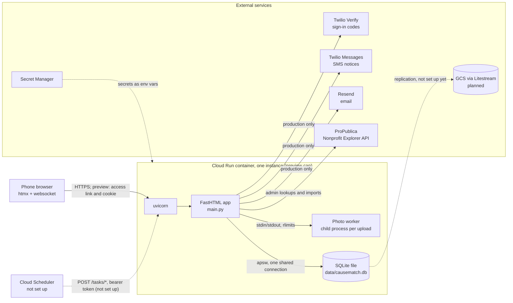

What is live and what is planned, based on the code and config in this repo:

| Piece | Status |
|---|---|
| Cloud Run preview (`causematch-preview`, `us-west1`) | **Live.** Password-protected, deployed by `scripts/deploy_preview.sh`. |
| SQLite file | **Live**, but in the preview it lives inside the container and is reseeded at each cold start. |
| Photo worker child process | **Live** (`app/photo_worker.py`). |
| ProPublica API | **Live.** Used by the claim page's name search, the admin orgs and claims pages and by `scripts/import_orgs.py` / `scripts/verify_org.py`. |
| Secret Manager | **Live** for the preview: `PREVIEW_PASSWORD`, `SESSION_SECRET`, `PHONE_HASH_KEY`, `TASKS_TOKEN`. |
| Twilio Verify and SMS, Resend email | **Implemented** (`app/notify.py`), **not live**. The preview runs the fakes (`CAUSEMATCH_FAKE_SMS=1`, `CAUSEMATCH_FAKE_EMAIL=1`). Production refuses to start without real credentials. |
| Cloud Scheduler calling `/tasks/reminders` and `/tasks/urgent` | **Not set up.** The endpoints exist and check a bearer token (`app/routes/tasks.py`), but nothing calls them: the Cloud Scheduler API isn't enabled in the project, and no script creates the jobs `docs/OPERATIONS.md` describes. In the preview they can't be called at all, because `PreviewGate` and the bearer check both read the one `Authorization` header. So the preview sends no day-before reminders, no accept-text retries and no urgent waves (the demo seed sends one wave directly). |
| Litestream to GCS | **Planned.** Mentioned only in a code comment (`app/db.py`, `Photo`). No configuration exists in the repo. |

The app runs as a single process whose state is local to the instance: the SQLite file on the container's disk, plus in memory the open chat sockets (`app/routes/chat.py`) and the token buckets (`app/security.py`). The preview deploy caps the service at one instance (`--max-instances 1`). Nothing sets that cap for production, which would need it (or shared state).

---

## 3. Request pipeline

`main.py` builds the app with `fast_app(...)`. FastHTML places user middleware ahead of its own session middleware, and Starlette runs the first middleware in the list outermost. The resulting order, inside Starlette's own `ServerErrorMiddleware` (outermost), with Starlette's `ExceptionMiddleware` (the 404 page) between the session and the router, is:

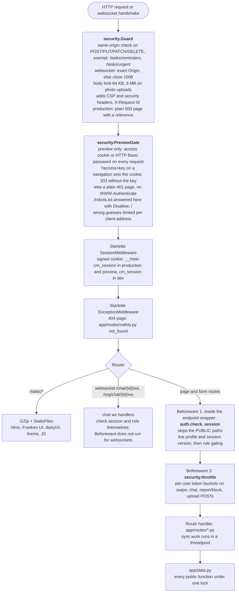

### Auth, sessions and roles (`app/auth.py`)

- **Public paths** skip the sign-in check: `/login`, `/login/send`, `/login/verify`, `/org/login`, `/org/login/send`, `/org/login/verify`, `/org/claim`, `/org/claim/search`, `/privacy`, `/tasks/reminders`, `/tasks/urgent`, `/urgent/off/{key}`, `/favicon.ico` and `/static/*`.
- **Session contents:** `uid` and `sv`, the session version. A request is signed in only if the profile still exists and isn't deleted or suspended, and `sv` equals the profile's `session_version`. Bumping that version signs out every device; sign-out, suspension and account deletion bump it. A deleted or suspended profile fails the check anyway, so removing an admin or coordinator also takes effect at once.
- **Role gating:**
  - `/admin/*`: admins only. A coordinator who tries is redirected to `/org`, anyone else gets 403.
  - `/org/*`: coordinators with at least one current org membership, checked on every request. Others get 403.
  - Volunteer pages: volunteers only. A coordinator is redirected to `/org`, and an admin gets 403.
  - A volunteer who hasn't finished onboarding is redirected to `/onboarding` (`/logout` stays reachable).
  - `/photos/*` is open to every signed-in role. `app/data.py` then decides who may see each photo (see section 8).
- **Websockets** apply the same rules through `auth.ws_session_user`, on connect, on every frame and before each push. It also refuses a volunteer who hasn't finished onboarding.
- Unmatched paths reach the 404 handler without running any Beforeware.

### htmx partials and full pages

Most pages are plain server-rendered HTML with ordinary form POSTs and redirects, so they work without JavaScript. htmx is used in two places:

- **Swiping.** The Like/Pass form posts with `hx-post="/swipe"` and swaps `#deck-area` with the next card. `POST /swipe` checks `HX-Request`: for htmx it returns the partial, or an `HX-Redirect` to the chat when an urgent call auto-accepted the like. Without htmx it redirects to `/deck`.
- **Chat.** The page connects with htmx's `ws` extension. The server pushes each new message to every open socket on that match as an out-of-band swap appended to `#messages`. `static/chat.js` reloads from the server's copy when the socket reconnects after a drop, or when the server refuses it with 1008. Each user may hold 5 sockets per match and 20 overall, and each frame takes a token from the chat bucket (close code 1013 when empty). `POST /chat/{id}/send` is the no-script fallback.

htmx, its ws extension, Franken UI and daisyUI are vendored under `static/vendor/`. `htmx-config` turns off eval and script tags.

---

## 4. Module map

Main dependencies (not exhaustive). Solid arrows read "imports / calls"; dotted arrows are configuration reads and one lazy import. Route modules never touch `app/db.py` directly: all reads and writes go through `app/data.py`.

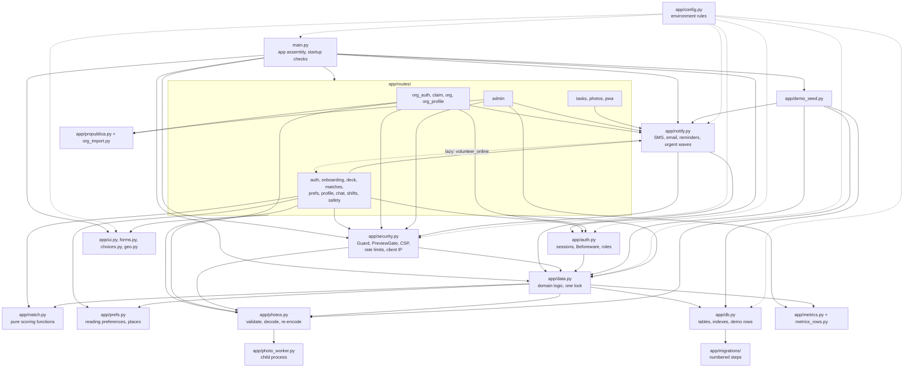

| Module | Responsibility |
|---|---|
| `main.py` | Startup refusals (environment, secrets, providers), uvicorn settings, `fast_app` with middleware and Beforeware, the static mount, router registration, seeding. |
| `app/config.py` | What each environment allows: `is_production`, `is_preview`, `is_dev`, `fakes_allowed`, plus required-value checks for every secret and setting. Has no imports from `app`. |
| `app/security.py` | `Guard`, `PreviewGate`, CSP and headers, body limits, client IP from `X-Forwarded-For`, persistent rate limits (`rate_event` table), in-memory token buckets, error pages, and the access-log token redaction. |
| `app/auth.py` | Session secret and cookie name, phone normalization, the Beforeware sign-in and role check, websocket session check. |
| `app/data.py` | All domain logic and every query the routes and services run, apart from the metrics queries (`app/metrics_rows.py`). Schema statements live in `app/db.py` and `app/migrations/`, and `app/demo_seed.py` writes seed rows through `app/db.py`'s tables. Covers the deck, swipes, matches, shifts, chat, urgent calls, notification bookkeeping, reports and blocks, claims, photos' access rules, account deletion and rate-event storage. Every public function runs under one re-entrant lock because a single apsw connection is shared by all threads. |
| `app/match.py` | Pure ranking functions: distance and travel time, cause fit, availability, work fit, language fit, and the weighted score. Has no database access. |
| `app/prefs.py` | Reads a volunteer's preferences consistently whatever the profile's age, and resolves a typed place (ZIP, neighborhood, device location) to a point. |
| `app/notify.py` | Twilio Verify, Twilio SMS, Resend email, and their fakes. Sends exactly-once notifications recorded in the `notification` table, day-before reminders and urgent-call waves. |
| `app/photos.py`, `app/photo_worker.py` | Upload validation, the sandboxed decode in a child process, and re-encoding to JPEG (full and thumbnail). |
| `app/db.py`, `app/migrations/` | Table classes (fastlite `transform=True`), indexes, the cause rows, invented demo orgs, and numbered migrations. |
| `app/metrics.py`, `app/metrics_rows.py` | Pilot metrics: plain-row queries, then pure aggregation. No names, phones or emails. |
| `app/propublica.py`, `app/org_import.py` | ProPublica API client, and the import rules: LA County ZIPs and NTEE code mapped to a cause. |
| `app/demo_seed.py` | Demo and preview data: invented or real orgs (from a seed file kept outside git) with "Sample:" openings and demo people. |
| `app/ui.py`, `app/forms.py`, `app/choices.py`, `app/geo.py` | Shared components and routers, form helpers, answer lists, and LA County ZIP and neighborhood lookups (`app/la_zips.csv`, `app/la_neighborhoods.csv`). |

---

## 5. Data model

There is one SQLite file (`CAUSEMATCH_DB`, default `data/causematch.db`), opened with fastlite and apsw. Each table except `schema_migrations` is a Python class in `app/db.py`. The schema declares **no foreign keys**: the relations below are enforced in `app/data.py`. Times are ISO strings, except `rate_event.at` (unix seconds): `created_at`-style stamps are UTC, while `starts_at` on openings, shifts and urgent calls is Los Angeles wall-clock time.

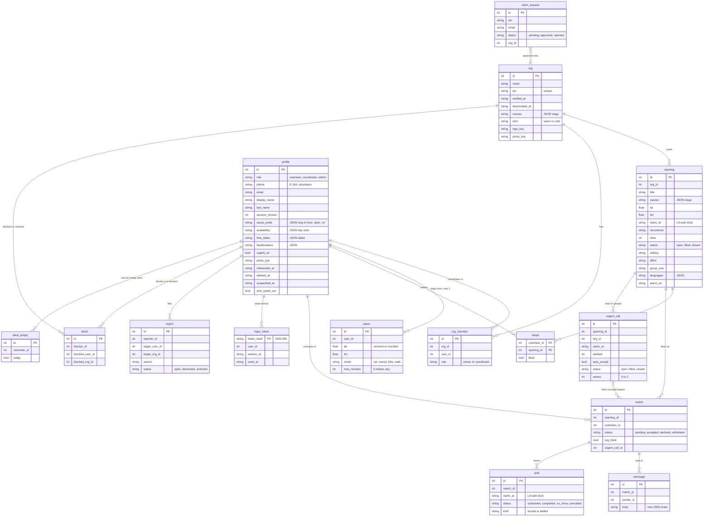

These tables stand on their own:

| Table | Holds |
|---|---|
| `cause` | The four causes (slug, label, icon, sort, active). Openings, orgs and profiles refer to causes by slug inside JSON lists. |
| `photo` | Re-encoded JPEG bytes (`full`, `thumb`) keyed by a random 22-character `key`. `owner_kind` is one of `volunteer`, `org_logo`, `org_photo`, `opening`, with `owner_id` pointing at the matching row. The bytes live in SQLite, so a database backup covers the photos too. |
| `notification` | One row per logical send. `key` is unique (for example `accepted:{match}`, `reminder:{shift}`, `urgent:{call}:{volunteer}`). `status` is one of `pending`, `sent`, `failed`, `skipped`, `cancelled`, `deferred` (held back by the SMS ceiling) or `unknown` (timed out). This is what makes notices exactly-once and retryable. |
| `rate_event` | One counted action for the persistent rate limits. The key is the limit name plus an HMAC of the phone, email or IP, never the value itself. Rows older than 24 h are pruned. |
| `retained_phone_hash` | An HMAC of a deleted account's phone, kept only when a block, report or suspension must survive deletion, so that it applies again if the number signs up later. |
| `schema_migrations` | Applied migration versions. |

Notable indexes, created in `app/db.py`:

- `swipe` primary key `(volunteer_id, opening_id)`: one swipe per card.
- `match (opening_id, volunteer_id)` unique: one match per like.
- `notification(key)` unique.
- `shift_match_start_live`: one live shift per match and start time.
- `profile_phone_live`: one live profile per phone.
- `coordinator_email_live` and `admin_email_live`: one live profile per email and role.
- `block_once_v2`: one block per side.

### Migrations

There are two mechanisms (`app/migrations/__init__.py`):

1. **Adding a column or table:** edit the class in `app/db.py`. `db.create(..., transform=True)` reshapes the table at startup.
2. **Renames, data changes, index changes on existing tables, and anything involving triggers:** add a numbered module `app/migrations/NNNN_what.py` with `up(conn)`, and also change the class to the end state.

Pending migrations run in order at every start, before the tables are declared. Each runs in its own transaction together with its `schema_migrations` row. A brand-new database records all migrations as applied without running them. You can also run them by hand with `uv run python -m app.migrations [--db PATH]`.

Current migrations:

- `0001_baseline`: a marker only.
- `0002_homelessness_active`: turns the homelessness cause on.
- `0010_cause_prefs`: picked causes become "love".
- `0011_day_slots`: weekday/weekend buckets become day slots.

---

## 6. Key flows

### Match lifecycle

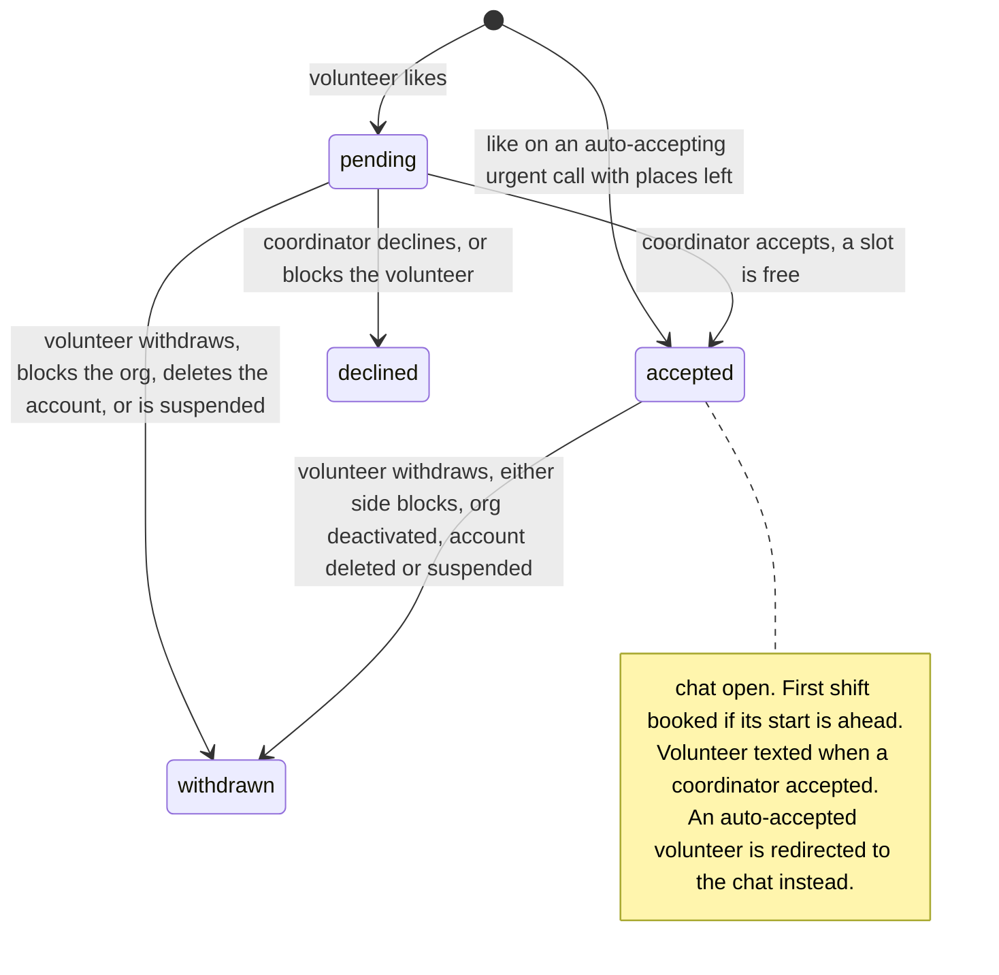

Three details the diagram doesn't show:

- An org deactivation turns pending matches into `declined`.
- When a match leaves `accepted`, its future shifts are cancelled and the opening switches back from `filled` to `open` if a slot freed up.
- Closing an opening closes its urgent call and cancels its future shifts. Its matches keep their status.

### (a) Volunteer sign-in by text code

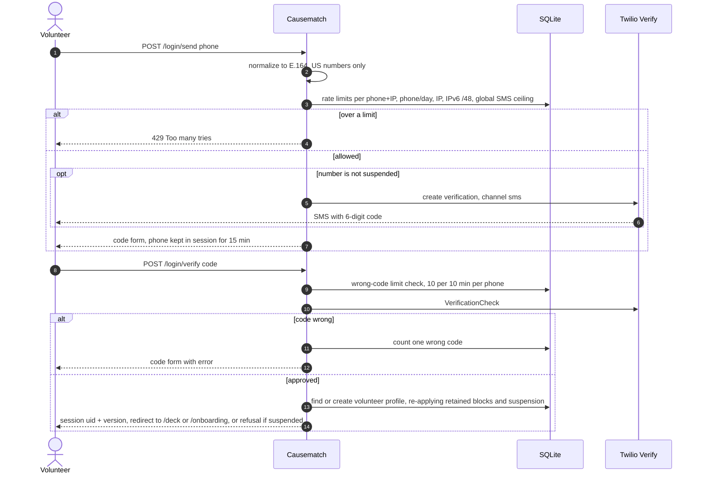

In development, test and preview with `CAUSEMATCH_FAKE_SMS=1`, no text is sent and the code is always `000000`.

### (b) Coordinator or admin sign-in by email link

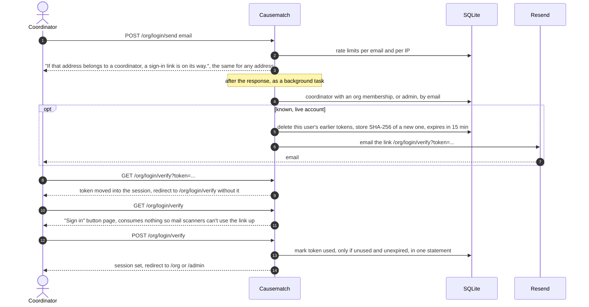

In a preview with the fake emailer, submitting a coordinator's address on `/org/login` shows that coordinator's link on the result page (never an admin's). The demo coordinator's and admin's links are also in the startup log, each valid once for 15 minutes.

### (c) Swipe, like, accept, shift, text, chat

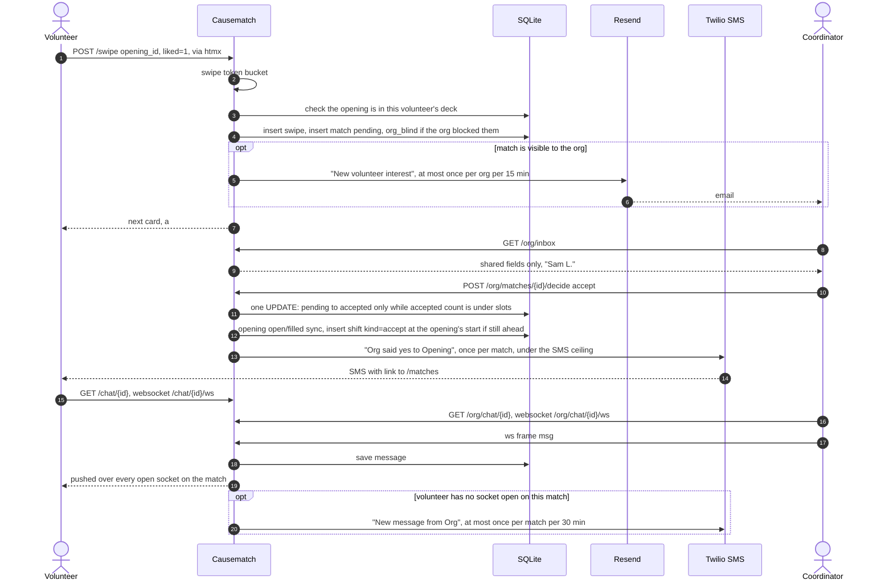

If the accepted match came from a like on an urgent call, the shift is booked at the call's time instead of the opening's. If the accept text fails, or is deferred by the SMS ceiling, the reminders task (`POST /tasks/reminders`, planned hourly, not set up) retries it, up to 5 attempts in all. A deferred try doesn't count as an attempt.

### (d) Urgent call: post, notification waves, auto-accept

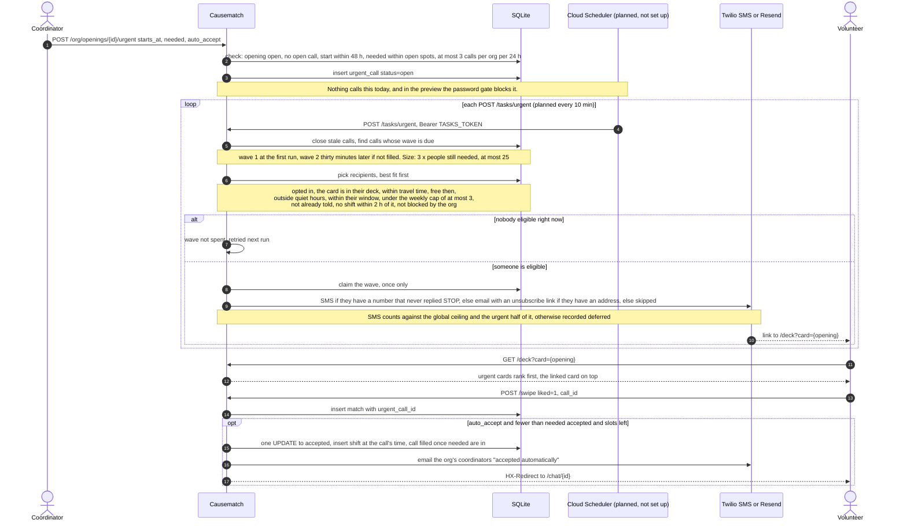

Edge cases:

- If a volunteer likes a card drawn before a call was posted on that opening, nothing is recorded and they are shown the call's card first.
- A like that arrives just after the call filled still counts toward it, but stays pending for the org.
- An urgent email's unsubscribe link `/urgent/off/{volunteer id}-{HMAC}` works signed out. `GET` only shows a page with a button; the `POST` is what turns calls off, so a mail scanner that fetches the link changes nothing. The email also carries a `List-Unsubscribe` header.

### (e) Day-before reminders and retries

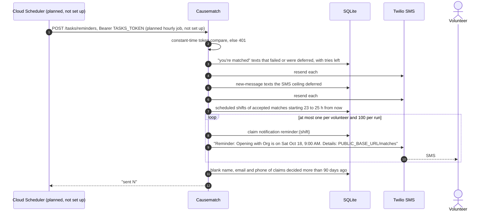

Once an hourly job calls it, the two-hour window puts each shift in at least one run, and the notification key keeps it to one send. No job calls it yet. A shift added less than 23 h before it starts never gets a reminder.

---

## 7. Matching and ranking

The deck is built in `app/data.py` from the volunteer's preferences (`app/prefs.py`), and scored by pure functions in `app/match.py`.

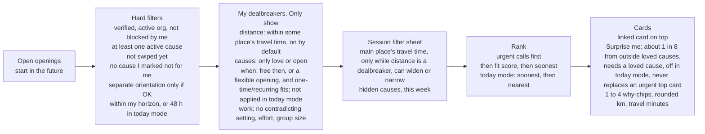

**Places and travel time.** A volunteer helps from at most 2 places. A place's point is either a ZIP or neighborhood centroid, or a device location rounded to 2 decimals (about 1 km) and checked to fall within a box around LA County. There's no routing API: travel minutes are the straight-line (haversine) distance divided by a door-to-door speed for the mode (car 32 km/h, transit 14, bike 13, walk 4.5). A place's reach is `max_minutes × speed`, and 0 means any distance. Each card is measured from whichever place gives the quickest trip. Remote openings skip distance entirely.

**Fit score** (`app/match.py`) is a weighted sum where each term is between 0 and 1:

| Term | Weight | How it's computed |
|---|---|---|
| Causes | 0.30 | Each of the opening's causes counts 1.0 if loved and 0.6 if open, divided by the size of the union of its causes and the volunteer's loved causes. |
| Distance | 0.18 | 1 at the place, falling linearly to 0 at the place's reach (60 km for "any"). Remote openings score 1. |
| Availability | 0.15 | 1 if the start falls in a ticked day slot or on a free date, 0.5 for a flexible opening, else 0. Halved if one-time/recurring doesn't fit. |
| Skills | 0.12 | The share of the opening's skills the volunteer has. 0.5 when the opening asks for none. |
| Work | 0.10 | Mean of four terms. Setting, effort and group size each score 1 if they agree, 0 if they differ, 0.5 if either side doesn't say. First-timer scores 1 when the volunteer asked for it and the opening is, else 0.5. |
| Reply rate | 0.10 | The org's share of eligible matches decided within 48 h. 0.5 with no history. |
| Language | 0.05 | 1 if the volunteer speaks a language the opening says helps, else 0.5. A language is never required. |

**Why-chips** explain each card, most telling first: up to two cause chips (♥ for loved), then "Surprise pick", travel time from a named place or "Remote", "You're free that day" or "You're free Sat mornings", first-timer friendly (here only if the volunteer asked for it), matching kinds of work, "Spanish helps"-style language chips, and last, first-timer friendly when the volunteer didn't ask for it. Normal cards show up to 4 chips. Urgent cards show 2, because their badge ("Urgent · tomorrow 9 am · needs 2") and an optional "Like and you're booked" line take the room.

**Empty deck.** Empty views are logged into `deck_empty` for the metrics, at most once per volunteer per hour, with today mode counted separately. The empty state offers the single change that would add the most cards: widen a place's travel time, look further ahead, drop one dealbreaker, or clear the filter sheet.

The same visibility check guards `POST /swipe`, so a like sent by id for an opening the volunteer couldn't see is refused. The same fit score orders who gets an urgent call's notices.

---

## 8. Security and privacy

### Who sees what, and when

| Data | Who sees it |
|---|---|
| Volunteer's phone, email, places, coordinates | Nobody else. Coordinates are never rendered, and cards show distance rounded to whole km plus a travel estimate. |
| Match preferences (cause ratings, dealbreakers, free dates, last-minute settings) | Only the volunteer. |
| What the volunteer shares (`SHARED_WITH_NONPROFIT` in `app/choices.py`): photo, first name and last initial, pronouns, bio, interests, causes (A to Z, without saying which are loved), general availability (weekday/weekend × part of day), languages, frequency, neighborhood | A nonprofit, only after the volunteer likes one of its openings. The inbox query selects only these columns. |
| Full last name | The nonprofit, once it accepts. |
| A volunteer's photo (`/photos/{key}.jpg`, `/photos/thumb/{key}.jpg`) | The volunteer, admins, and coordinators of an org whose inbox shows one of their matches, with no block either way. Anyone else gets 404, the same as for a missing photo. It's always revalidated (`private, no-cache`), so a block or removal hides it at once. |
| Org logo and photos, opening photos | Anyone signed in. These may be cached for a day. |
| After a block, either way | The volunteer's waiting and decided rows leave the org's inbox. Past matches and shifts stay, labelled only "Volunteer", with no photo or details. A like from a volunteer the org blocked looks normal to the volunteer but never reaches the org (`org_blind`). |
| Pilot metrics | Admins only. Aggregates, small groups merged, no names, phones or emails. |

### Photo pipeline (`app/photos.py`, `app/photo_worker.py`)

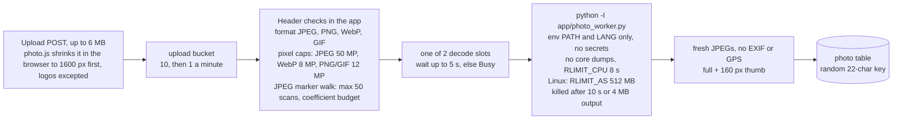

The child process runs as the same user as the app: it limits resources but doesn't drop privileges. macOS doesn't enforce `RLIMIT_AS`, so in development only the CPU limit and the timeout apply. CI checks that the memory cap really runs on Linux.

### Request-level defences (`app/security.py`)

- **Same-origin writes.** Every unsafe method needs `Origin` equal to `PUBLIC_BASE_URL`'s origin or, when the browser sends no `Origin`, a `Referer` on it. The only exemptions are `/tasks/reminders` and `/tasks/urgent`. Websockets need the exact `Origin`.
- **Headers on every response:**
  - A CSP of `default-src 'self'`, `script-src 'self'`, `style-src 'self'` with no inline code, `img-src 'self' data: blob:`, `connect-src 'self'` plus the ws origin, `font-src 'self'`, `frame-ancestors 'none'`, `base-uri 'self'`, `form-action 'self'` and `object-src 'none'`.
  - `X-Frame-Options: DENY`, `nosniff`, `strict-origin-when-cross-origin`.
  - A permissions policy that allows geolocation only on `/onboarding` and `/me/preferences`.
  - `Cache-Control: no-store`, except on `/static` and `/favicon.ico`, unless the route sets its own (photos do).
  - HSTS in production and preview.
  - `X-Robots-Tag: noindex, nofollow` in preview.
- **Body limits:** 64 KB, or 6 MB on photo upload paths. Over that, 413.
- **Errors in production:** a plain 500 page with a reference id. The log line keeps the request id and stack frames but not the exception message, which could hold a phone number. The uvicorn access log redacts `token=`, and the logs mask phones and emails.
- **Client IP:** taken from `X-Forwarded-For`, exactly `TRUSTED_PROXY_HOPS` places from the right. IPv6 clients are counted per /64.

Rate limits fall into two kinds:

| Kind | Limits |
|---|---|
| Persistent, stored in `rate_event` so a restart doesn't reset them | **Sign-in codes:** 5 per 10 min and 10 per day per (phone, IP); 20 per day per phone; 60 per hour per IP; 120 per hour per IPv6 /48. **Wrong codes:** 10 per 10 min per phone. **Email links:** 5 per hour per email, 20 per hour per IP. **Claims:** 5 per hour per IP, 3 per day per email. **ProPublica calls:** 30 per hour across all admins; the claim page's name search has its own, 30 per hour per IP and 300 per hour for every visitor together. **SMS ceiling** on every text: `SMS_MAX_PER_HOUR` (default 100) and `SMS_MAX_PER_DAY` (default 500). Urgent waves may use only half of each, so sign-in codes always have room. |
| In-memory token buckets per user | Swipe: 30, then 1 per second. Chat: 20, then 2 per second. Report/block: 10, then 1 every 6 minutes. Uploads: 10, then 1 per minute. Wrong preview keys, cookies and passwords: 10 per client address, then 1 per minute. |

HTTP requests over a limit get a 429 page with `Retry-After` (600 s for the persistent limits). Chat frames over the bucket close the socket with 1013. Texts over the SMS ceiling are deferred. A reporter may also file at most 10 reports in any 24 hours, counted from the `report` table; the 11th is refused on the form.

### Preview gate

When `CAUSEMATCH_ENV=preview` and `PREVIEW_PASSWORD` has at least 16 characters, `PreviewGate` lets a request through only with the access cookie or the password by HTTP Basic auth, on every request: pages, `/static`, `/photos`, `/tasks` and websocket handshakes, so in a preview nothing can call `/tasks/*` (see section 2). The link people are sent carries the password as `?access=`. On a top-level navigation (`Sec-Fetch-Dest: document` with `Sec-Fetch-Mode: navigate`, or no Sec-Fetch headers, as from curl) a GET with the right key gets a 303 to the same URL without the key and the cookie `__Host-cm_preview` (Secure, HttpOnly, SameSite=Lax, 30 days). Any other request with `?access=` is refused without weighing the key, so a foreign page's `` can't use up a visitor's guesses; a browser that has the cookie just gets the 303 without the key. The cookie is `<issue time>.<mac>`, the mac an HMAC-SHA256 keyed with `SESSION_SECRET` over a label, the password's SHA-256 and the issue time: it can't be made without the secret, expires after 30 days on the server side too, and a new password (or session secret) voids every one. Basic auth (any user name) stays for scripts. The password is compared in constant time on SHA-256 digests. Anything else gets a plain 401 page with no `WWW-Authenticate`, so browsers show no dialog; websockets are closed with 1008. Wrong keys, cookies and passwords share the per-address limit above. Only `/robots.txt` answers without it, with `Disallow: /`.

### Secrets and what never enters git

- **Secrets come from the environment**, through Secret Manager on Cloud Run: `SESSION_SECRET`, `PHONE_HASH_KEY`, `TASKS_TOKEN`, `PREVIEW_PASSWORD`, Twilio and Resend keys. In production the first three must be at least 32 characters.
- **`PHONE_HASH_KEY`** keys several HMACs: rate-limit keys, retained phone hashes after deletion, and urgent unsubscribe links.
- **Excluded by `.gitignore`:**
  - `data/`, `*.db`
  - `.env*`, except `.env.example`
  - screenshots
  - `preview-seed/`, the real-nonprofit seed copied in only for a preview build; `.gcloudignore` re-includes it for Cloud Build
  - agent files (`.omc/`, `CLAUDE.md`, `.claude/`)
- **Secret scanning:** `scripts/secret_scan.sh` runs gitleaks over the whole history. Locally it skips when gitleaks isn't installed; in CI a missing gitleaks fails the job.
- **Seed safety:** `scripts/deploy_preview.sh` refuses to copy the seed if `preview-seed/` is tracked or not ignored.
- **Account deletion** scrubs personal columns and photos, deletes places and login tokens, withdraws matches, cancels future shifts and its pending and failed texts, replaces sent messages with "[message removed]" and ends every session. It keeps only the answers the metrics group by.

---

## 9. Environments and deploy

`CAUSEMATCH_ENV` must be declared. With it unset, the app refuses to start unless it is on Cloud Run (`K_SERVICE` set), which always counts as production. A preview is production plus a password gate and a few demo allowances (`app/config.py`).

| | development / test | preview | production |
|---|---|---|---|
| Set by | `CAUSEMATCH_ENV=development` or `test` | `CAUSEMATCH_ENV=preview` + `PREVIEW_PASSWORD` (16+ chars) | `CAUSEMATCH_ENV=production`, or Cloud Run |
| Production rules (strong secrets, https origin, `__Host-` cookie, HSTS, plain 500 page) | no | yes | yes |
| Session secret | public dev default if unset | required, 32+ chars | required, 32+ chars |
| Fake SMS (code `000000`) and fake email (logged) | allowed with `CAUSEMATCH_FAKE_SMS=1` / `CAUSEMATCH_FAKE_EMAIL=1` | allowed, and set by the deploy script | refused at startup |
| Password on every request | no | yes, `PreviewGate` | no |
| Banner on every page | only with `CAUSEMATCH_DEMO_BANNER=1` (`scripts/demo.py --seed-file`) | always ("Preview") | refused at startup |
| Demo matches: a fresh demo volunteer per sign-in with `(310) 555-0100`, and stand-in coordinators that accept a like after a few seconds | with `CAUSEMATCH_DEMO_MATCHES=1` (`scripts/demo.py`) | with `CAUSEMATCH_DEMO_MATCHES=1`, set by the deploy script | refused at startup |
| Seeding | invented orgs from `app/db.py` into an empty database (verified in dev and test) | `app/demo_seed.py` into an empty database at each cold start: `PREVIEW_SEED_DIR`, else the invented orgs, plus demo people | none |
| Coordinator sign-in link | emailed by the fake, i.e. logged | shown on the `/org/login` result page for a coordinator's address (never an admin's); demo coordinator and admin links in the startup log | emailed by Resend |

Local options:

- `uv run python main.py`: run the app.
- `uv run python scripts/demo.py [--seed-file PATH]`: a throwaway database with demo data. It prints how to sign in as each role and refuses production.
- `scripts/screenshots.py --out DIR`: screenshot every page of the demo.

### Container and preview deploy

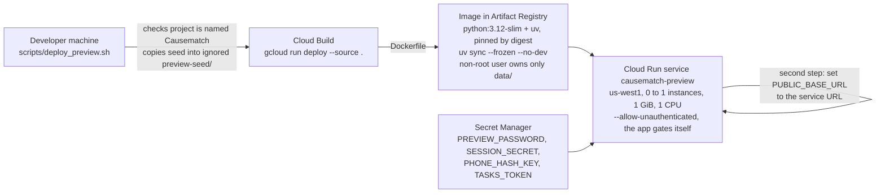

- **`Dockerfile`:** the image's `CMD` runs uvicorn with the `Procfile`'s flags (`--ws-max-size 65536`, `--limit-concurrency 200`, `--timeout-keep-alive 15`, `--timeout-graceful-shutdown 8`, `--no-proxy-headers`) on `$PORT`, default 8080.
- **`scripts/deploy_preview.sh`** sets `CAUSEMATCH_ENV=preview`, `PREVIEW_SEED_DIR=/app/preview-seed`, `TRUSTED_PROXY_HOPS=1`, both fakes, `CAUSEMATCH_DEMO_MATCHES=1`, `CONTACT_EMAIL` and `PUBLIC_BASE_URL`. The seed also ends up in the Cloud Build source bucket and in the image. Both are private to the project.
- **Production is not deployed yet.** The code expects these additions:
  - real Twilio and Resend credentials
  - a persistent database (Litestream replication to GCS is the plan)
  - the two Cloud Scheduler jobs (`/tasks/reminders` hourly, `/tasks/urgent` every 10 minutes): the API is not enabled in the project and no script creates them. A preview would also need a way past `PreviewGate` for them, since the gate and the bearer check share the `Authorization` header.
  - at least 1 GiB of memory, for two worst-case photo decodes at once

### Environment variables

| Name | Purpose | Required |
|---|---|---|
| `CAUSEMATCH_ENV` | `development`, `test`, `preview` or `production` | always, except on Cloud Run |
| `SESSION_SECRET` | Signs the session cookie | production, preview (32+) |
| `PUBLIC_BASE_URL` | The app's origin: emailed links, the same-origin check, CSP. Never read from the request. | production, preview (`https://`, origin only); dev defaults to `http://localhost:5001` |
| `TASKS_TOKEN` | Bearer token for `/tasks/*` | production, preview (32+) |
| `PHONE_HASH_KEY` | HMAC key: rate-limit keys, retained phone hashes, unsubscribe links | production, preview (32+) |
| `CONTACT_EMAIL` | Address on `/privacy` and in claim emails | production, preview |
| `TRUSTED_PROXY_HOPS` | Proxies appending to `X-Forwarded-For`: 1 for `*.run.app`, 2 behind a load balancer | on Cloud Run |
| `TWILIO_ACCOUNT_SID`, `TWILIO_AUTH_TOKEN`, `TWILIO_VERIFY_SID` | Sign-in codes | unless `CAUSEMATCH_FAKE_SMS=1` |
| `TWILIO_FROM_NUMBER` | Sender of notification texts | unless `CAUSEMATCH_FAKE_SMS=1` |
| `EMAIL_API_KEY`, `EMAIL_FROM` | Resend | unless `CAUSEMATCH_FAKE_EMAIL=1` |
| `PREVIEW_PASSWORD` | The preview's access key (`?access=` link) and HTTP Basic password | preview (16+) |
| `PREVIEW_SEED_DIR` | Folder with `orgs.json`, `logos-raw/`, `photos-raw/` | optional, preview |
| `CAUSEMATCH_FAKE_SMS`, `CAUSEMATCH_FAKE_EMAIL` | `1` = fakes | optional; dev, test, preview only |
| `CAUSEMATCH_DEMO_BANNER` | `1` = demo banner (set by `scripts/demo.py --seed-file`) | optional; refused in production |
| `CAUSEMATCH_DEMO_MATCHES` | `1` = a fresh demo volunteer per sign-in with the demo number, and stand-in coordinators that accept likes (set by `scripts/demo.py` and the preview deploy) | optional; dev, test, preview only |
| `CAUSEMATCH_DB` | SQLite path, default `data/causematch.db` | optional |
| `SMS_MAX_PER_HOUR`, `SMS_MAX_PER_DAY` | Global SMS ceiling, defaults 100 / 500 | optional |
| `CAUSEMATCH_LOG_LEVEL` | `DEBUG` adds a hashed client key per limited request | optional |
| `PORT`, `K_SERVICE` | Set by Cloud Run | n/a |

`.env.example` lists the variables without values. `CAUSEMATCH_DEMO_BANNER` is read in `app/config.py` but isn't listed there.

---

## 10. Testing and CI

| Part | What it covers |
|---|---|
| `tests/conftest.py` | Before importing the app it sets `CAUSEMATCH_ENV=test`, a temporary `CAUSEMATCH_DB`, both fakes and `PUBLIC_BASE_URL=https://causematch.test`. It replaces Starlette's `TestClient` with one that sends the same `Origin` a browser would, and provides fixtures for fresh databases and signed-in volunteers and coordinators. The `live_url` fixture runs the real app under uvicorn in a thread on a free port, for browser tests. |
| `tests/test_*.py` (30 modules) | One module per area: access and roles, auth, org auth, claims, deck, matching (`test_match*.py`), prefs, onboarding, openings, urgent calls, shifts, chat and threads, notify, safety, security, preview, photos, org media, profile, metrics, import, db and migrations, PWA, UI. |
| `tests/e2e/` | Playwright with Chromium, often at iPhone 13 size, against `live_url`: swipe and drag, live chat between two browsers, the deck fitting one screen, preferences, photo upload, layout and tap targets. Marked `e2e`. |
| `tests/fixtures/propublica/` | Recorded ProPublica API responses, so tests never call the network. |

`pyproject.toml` sets a 300 s per-test timeout (`pytest-timeout`) and the `e2e` and `perf` markers.

CI (`.github/workflows/ci.yml`) runs on pushes to `main` and on pull requests, on `ubuntu-latest`:

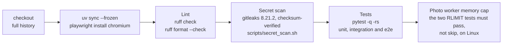

---

## 11. Where to go next, and a glossary

### Where to go next

- **New to the code:** read `main.py`, then `app/auth.py` and `app/security.py`, then one vertical slice. A good one is `app/routes/deck.py`, then the deck functions in `app/data.py`, then `app/match.py`.
- **Changing the schema:** see section 5 and the docstring in `app/migrations/__init__.py`.
- **Adding a POST route:** it gets the same-origin check automatically. Add the route to `PUBLIC` in `app/auth.py` only if it must work signed out. A new upload path needs an entry in `security.UPLOADS`, and a new scheduler path needs `ORIGIN_EXEMPT` plus its own bearer-token check.
- **Adding Tailwind classes:** run `scripts/build_css.sh` and commit `static/vendor/app.css`.
- **Operations:** see `docs/OPERATIONS.md` (configuration, scheduled jobs, security notes, preview deploy) and `scripts/`.

### Glossary

| Term | Meaning |
|---|---|
| **Opening** | A volunteering opportunity a nonprofit posts: title, cause, place, next start time, recurrence, slots. Status is `open`, `filled` (accepted matches reached slots) or `closed`. |
| **Card / deck** | The volunteer's ranked stack of openings, shown one card at a time. |
| **Swipe** | A Like or Pass on a card. There is one per volunteer and opening, and a card never comes back. |
| **Like** | A swipe right. It creates a pending match. |
| **Match** | A like and its outcome: `pending`, `accepted`, `declined` or `withdrawn`. |
| **Accept** | The coordinator's yes. It books the first shift (when its start is still ahead), texts the volunteer and opens the chat. |
| **Shift** | One dated occurrence of volunteering on an accepted match. Status is `scheduled`, `completed`, `no_show` or `cancelled`. The first is created on accept (`kind=accept`), and later ones are added by the coordinator (`kind=added`). |
| **Urgent call / last-minute call** | "Need N more for this shift in the next 48 hours" on an open opening. It triggers notification waves and can auto-accept likes. |
| **Wave** | One batch of urgent notifications. There are at most 2 per call, 30 minutes apart. |
| **Auto-accept** | An urgent call option where the first N likes are accepted without a coordinator decision. |
| **Cause rating** | Love, open, or not for me, per cause. "Not for me" always hides. |
| **Dealbreaker** | A preference set to "Only show", which hides non-fitting openings instead of only ranking them lower. Distance is on by default. |
| **Place** | Where a volunteer helps from (max 2), with a travel mode and max minutes. It is never an address. |
| **Fit score** | The weighted 0 to 1 score that orders the deck and urgent recipients (section 7). |
| **Why-chip** | A short reason on a card ("♥ Animal shelters", "12 min by bike from Home"). |
| **"Free in the next 48h"** | Deck mode limited to shifts starting within 48 hours, sorted soonest first. |
| **Surprise me** | About one card in 8 comes from outside the volunteer's loved causes. |
| **Filter sheet / view** | Temporary deck filters kept in the session, separate from saved preferences. |
| **Coordinator / owner** | A nonprofit staff member with membership in an org. The owner is the first approved claimant. |
| **Claim** | A public request to manage an org, decided by an admin. |
| **Verified org** | An org whose EIN an admin checked. Only verified, non-deactivated orgs appear in decks. |
| **Org-blind like** | A like from a volunteer the org blocked. It's recorded but never shown to the org. |
| **Preview** | The password-protected Cloud Run deploy with demo data and fake SMS and email. |
| **Session version** | A counter on the profile. Bumping it signs out every device. |
| **SMS ceiling** | The global hourly and daily cap on texts. Notifications over it are deferred, and urgent waves get half of it. |
